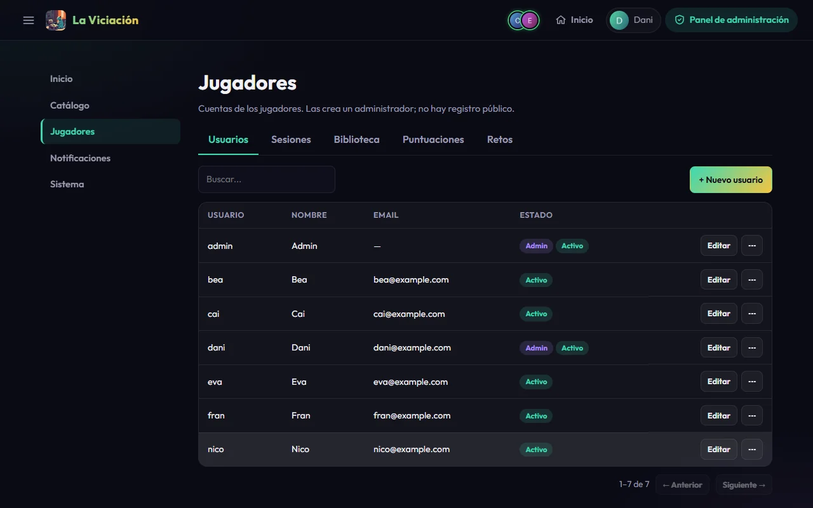
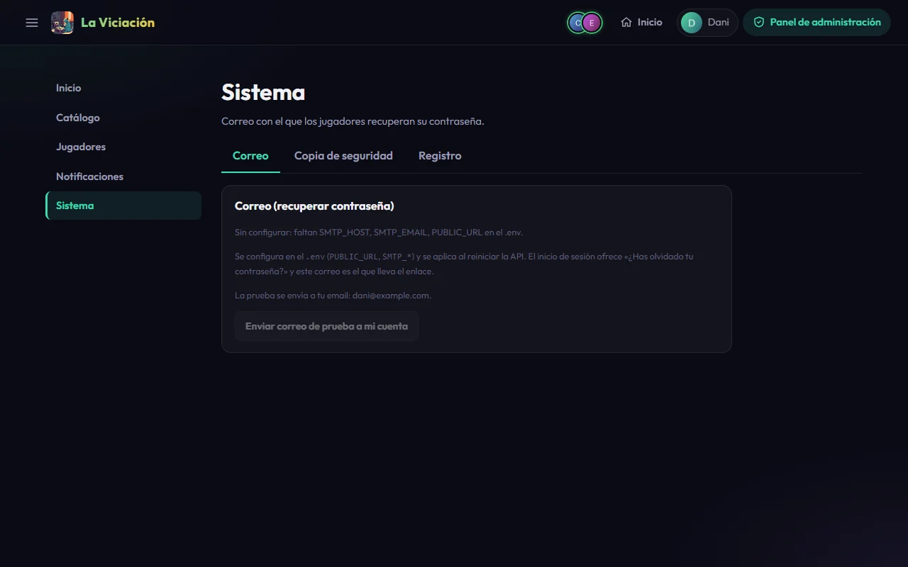

# Cuentas y acceso

## Crear a los jugadores

No hay registro público: **los administradores crean las cuentas**. En el panel, **Jugadores → Usuarios → Nuevo usuario**.

{ .screenshot }

Para cada jugador se piden:

- **Usuario**: su apodo único (sin `@` ni espacios).
- **Email**: es el identificador para entrar (único, se guarda en minúsculas). Al entrar vale tanto el email como el usuario.
- **Contraseña inicial**: de 12 a 24 caracteres, con mayúscula, minúscula, número y un carácter especial. Se la das tú; luego puede cambiarla desde su perfil.
- **Nombre**, **Telegram ID** (opcional, es único) y si es **administrador** y si está **activo**.

!!! tip "Para que el bot reconozca a cada uno"
    Pon como **usuario** el mismo `@usuario` que tenga en Telegram: con eso podrá vincular su cuenta escribiendo `/activate` en el grupo. Ver [Telegram](telegram.md).

Una cuenta **desactivada** no puede entrar ni actuar, pero conserva su historial: sigue contando en rankings y estadísticas de la app, y se marca como «Inactivo» (el bot y los avisos la ignoran). Puedes editar, restablecer la contraseña o borrar cualquier cuenta desde el menú de su fila; borrar a alguien elimina también sus sesiones, su biblioteca y sus logros, y el panel te pide confirmación.

## Cómo funciona el acceso

- **La cuenta `admin`**: en cada arranque la API la crea o restaura con `GOD_ADMIN_PASS`. Es una cuenta de emergencia, no un jugador, y no tiene email.
- **Intentos fallidos**: 5 por cuenta y, cuando la API conoce la IP real del cliente (ver `FORWARDED_ALLOW_IPS`), 40 por IP cada 15 minutos. Después, la respuesta es un error 429 hasta que pasa la ventana. Los contadores viven en memoria: reiniciar la API los borra.
- **Cambiar o restablecer una contraseña** (por el jugador o por un administrador) cierra la sesión de esa cuenta en todos sus dispositivos.
- **Duración de la sesión**: `ACCESS_TOKEN_EXPIRE_MINUTES` (7 días por defecto). La app renueva la sesión cuando ha pasado la mitad, así que solo caduca una sesión que no se use en todo ese tiempo.

## Recuperar la contraseña por correo

La pantalla de acceso tiene **¿Has olvidado tu contraseña?**: el jugador escribe su email o usuario y recibe un enlace de un solo uso, válido 1 hora. Necesita un servidor SMTP. Sin él, la API responde que la recuperación no está configurada, y un administrador siempre puede poner una contraseña desde **Usuarios → Editar**.

Configúralo en el `.env`:

```ini
PUBLIC_URL=https://lavi.ejemplo.com   # a donde apunta el enlace del correo
SMTP_HOST=smtp.ejemplo.com
SMTP_PORT=587
SMTP_SECURITY=starttls                # o ssl, con el puerto 465
SMTP_EMAIL=lavi@ejemplo.com           # remitente
SMTP_USER=lavi@ejemplo.com            # si el servidor pide login
SMTP_PASS=la-contraseña-smtp
```

Reinicia (`docker compose up -d`) y comprueba la configuración en **Sistema → Servicios**: te dice si el correo está configurado (o qué variables faltan, y qué servidor y remitente usa, nunca la contraseña) y un botón envía un correo de prueba **a tu propio email**.

{ .screenshot }

Algunos detalles de seguridad: la respuesta nunca revela si una cuenta existe, el enlace solo se puede usar una vez y al usarlo se cierran todas las sesiones de esa cuenta. Las cuentas sin email (como `admin`) no pueden usar la recuperación. Si un remitente es nuevo, revisa la carpeta de spam.
