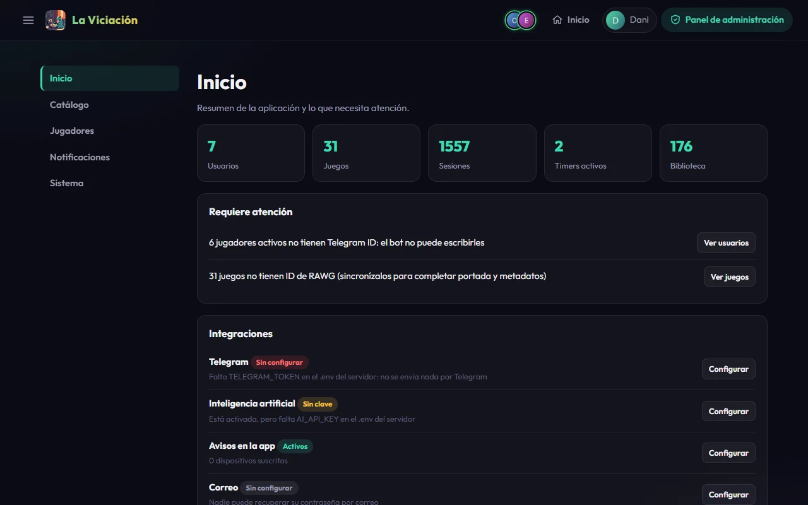
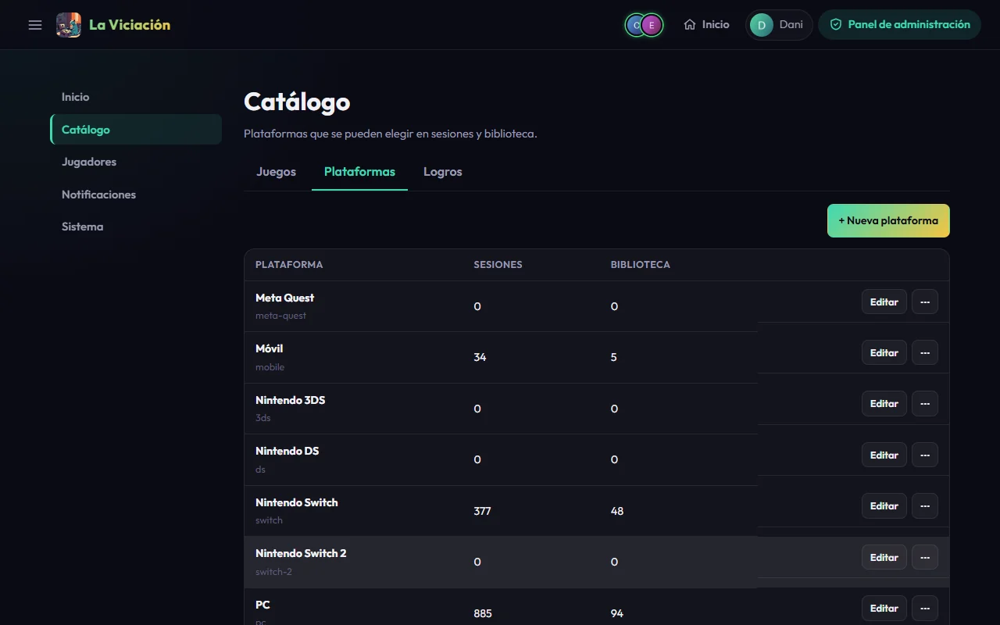
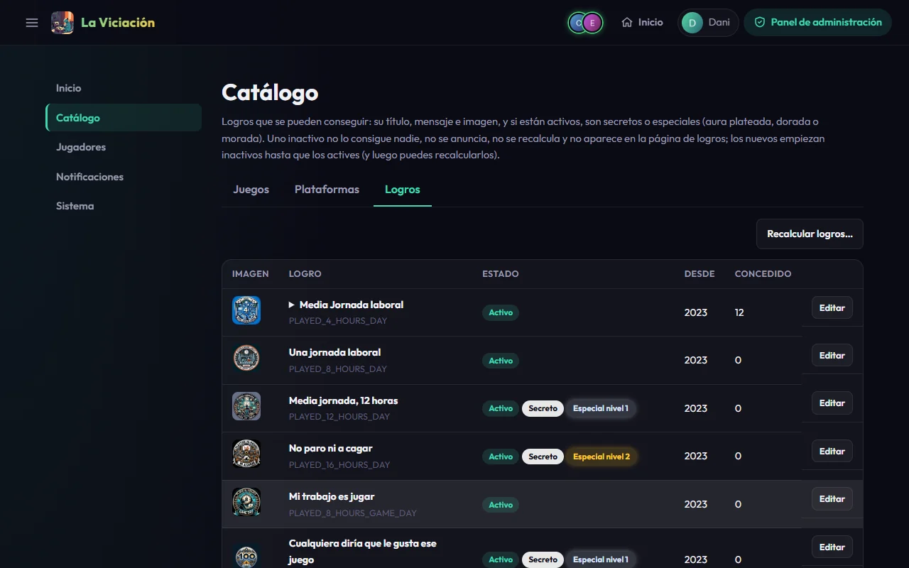
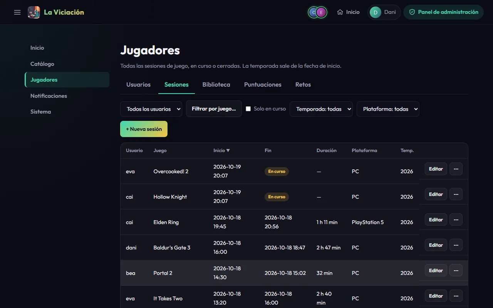
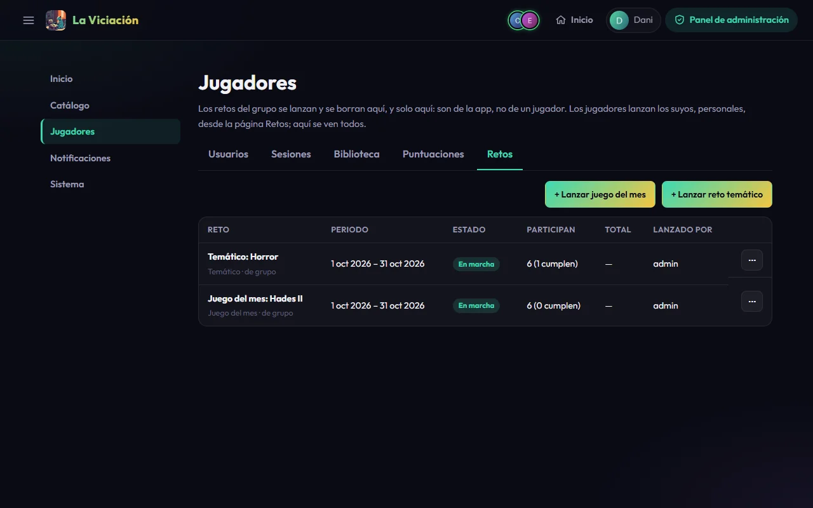
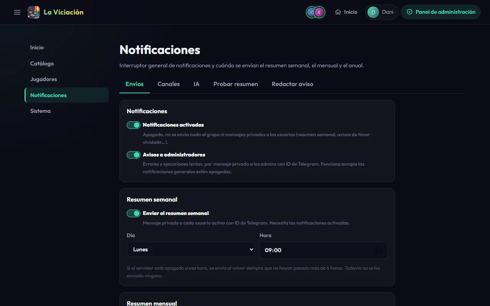
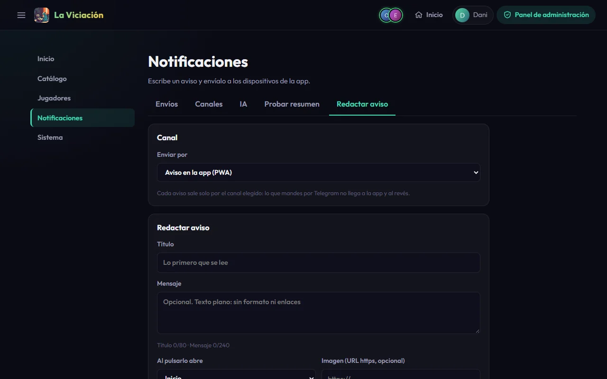
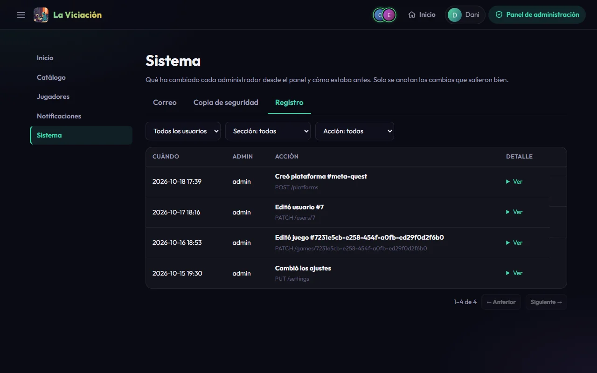

# Panel de administración

Los administradores ven en el menú lateral **Administración → Panel de administración**. Cada sección tiene sus pestañas, y cada cambio que haces queda en el [registro](#sistema).

## Inicio

Un resumen de la instalación: cuántos usuarios, juegos, sesiones, timers activos y entradas de biblioteca hay; **Requiere atención** (por ejemplo, jugadores sin Telegram o juegos sin ID de RAWG, con un enlace directo para arreglarlos) y **Integraciones**, que te dice qué servicios faltan por configurar.

{ .screenshot }

## Catálogo

### Juegos

La lista de todos los juegos con búsqueda, orden y filtros. **Editar** cambia cualquier dato (nombre, desarrollador, fecha, géneros, etiquetas, portada, tiempo medio…). Aquí están también las sincronizaciones con RAWG y HowLongToBeat: ver [Servicios externos](servicios.md).

### Plataformas

El catálogo de plataformas que se pueden elegir en sesiones y biblioteca. Puedes **añadir** una (su identificador sale del nombre y no cambia nunca), **renombrarla** (todo lo que la usa la sigue) y **borrar** una que nadie use. Si aún tiene sesiones o entradas, te dice cuántas.

{ .screenshot }

### Logros

Todos los logros con su estado. Pulsa uno para ver quién lo ha conseguido y cuándo. Por cada logro puedes cambiar:

- **Activo**: apagado, nadie lo gana ni se anuncia, pero lo ya ganado se conserva.
- **Secreto**: oculto para quien no lo tiene.
- **Especial** (nivel 1 plateado, 2 dorado, 3 morado): le da el aura. Los especiales son también secretos.
- **Desde**: la temporada en la que empieza a contar. Los nuevos logros empiezan en 2027.
- El texto y la imagen.

En cada logro de un jugador, **Editar** cambia la fecha en que lo consiguió y **Revocar** lo retira sin avisar. Ojo: si el jugador sigue cumpliendo la condición, se volverá a conceder en la siguiente comprobación; corrige antes el dato que lo provocó.

{ .screenshot }

**Recalcular logros…** vuelve a calcular todos los logros de todas las temporadas a partir de las sesiones y la biblioteca, **sin avisar a nadie**. Funciona en dos pasos: una vista previa de lo que añadiría, corregiría y revocaría, y, tras escribir `RECALCULAR`, el recálculo en segundo plano. Puedes elegir jugadores, temporadas y logros. Úsalo cuando importes historial o cuando arregles datos antiguos.

## Jugadores

- **Usuarios**: crear, editar y desactivar cuentas (ver [Cuentas y acceso](cuentas.md)).
- **Sesiones**: todas las sesiones de todos, con filtros. Puedes **crear una sesión a mano** (para un timer olvidado, por ejemplo), editar el juego, la plataforma, el inicio o el fin de cualquiera, incluso de temporadas cerradas, y cerrar un timer atascado poniéndole un fin. Los cambios de un administrador no avisan al grupo.
- **Biblioteca**: las entradas de biblioteca de cada jugador, con su fecha de completado y la marca de abandonado.
- **Puntuaciones**: crear, cambiar y borrar notas de cualquier jugador.
- **Retos**: lanzar los retos del grupo (**Lanzar juego del mes** y **Lanzar reto temático**), con un interruptor para avisar al grupo, y borrar cualquiera (también los personales).

{ .screenshot }

{ .screenshot }

## Notificaciones

- **Envíos**: el interruptor general de notificaciones, el de avisos a administradores, y los envíos programados: resumen semanal (día y hora), resumen mensual y resumen anual (apagados por defecto).
- **Canales**: Telegram (estado y mensaje de prueba) y avisos en la app (push).
- **IA**: la configuración y los textos de los avisos que reescribe la IA.
- **Probar resumen**: previsualiza el resumen de cualquier mes o temporada para cualquier jugador, enseña el aviso tal como saldría (sin enviarlo) y permite enviarlo ahora solo a ti o al grupo.
- **Redactar aviso**: escribe un mensaje propio, con título (80 caracteres) y mensaje (240), y envíalo por **un** canal: la **app** (push) o **Telegram**; a tus dispositivos, a un jugador, al grupo o a todos. Enviar al grupo o a todos pide confirmación.

{ .screenshot }

{ .screenshot }

## Sistema

- **Correo**: estado del correo de recuperación y correo de prueba (ver [Cuentas y acceso](cuentas.md)).
- **Copia de seguridad**: **Descargar copia (.sql.gz)** genera un volcado completo de la base de datos (usuarios, sesiones, biblioteca, logros, ajustes y fotos). Ver [Operación](operacion.md).
- **Registro**: qué ha cambiado cada administrador desde el panel, de lo más reciente a lo más antiguo, con un **Ver** que despliega cómo estaba antes y qué se envió. Se puede filtrar por administrador, sección y tipo de acción. Las contraseñas, tokens y claves nunca aparecen, y no registra lo que hacen los jugadores en su propia cuenta.

{ .screenshot }
