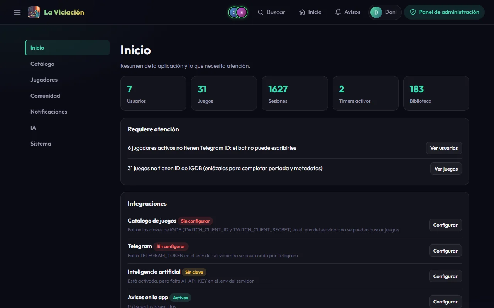
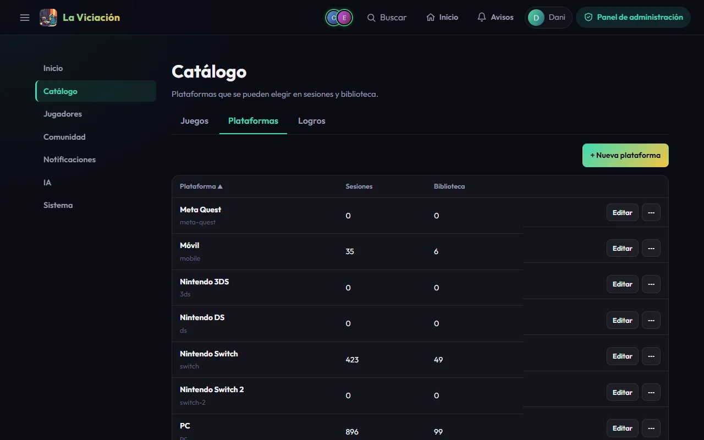
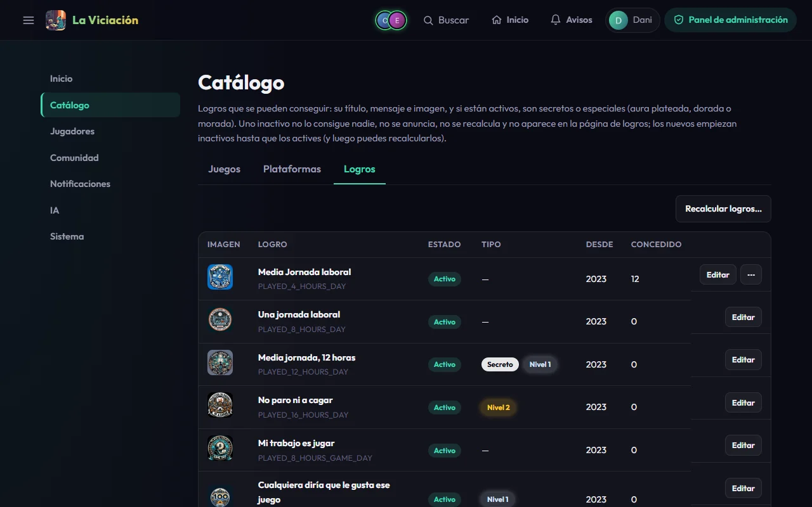
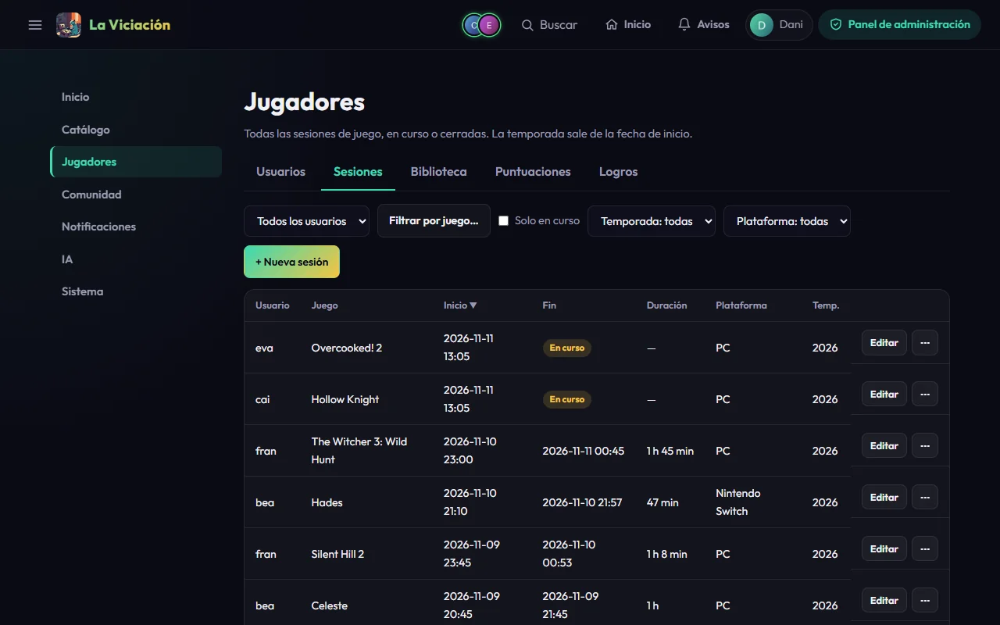
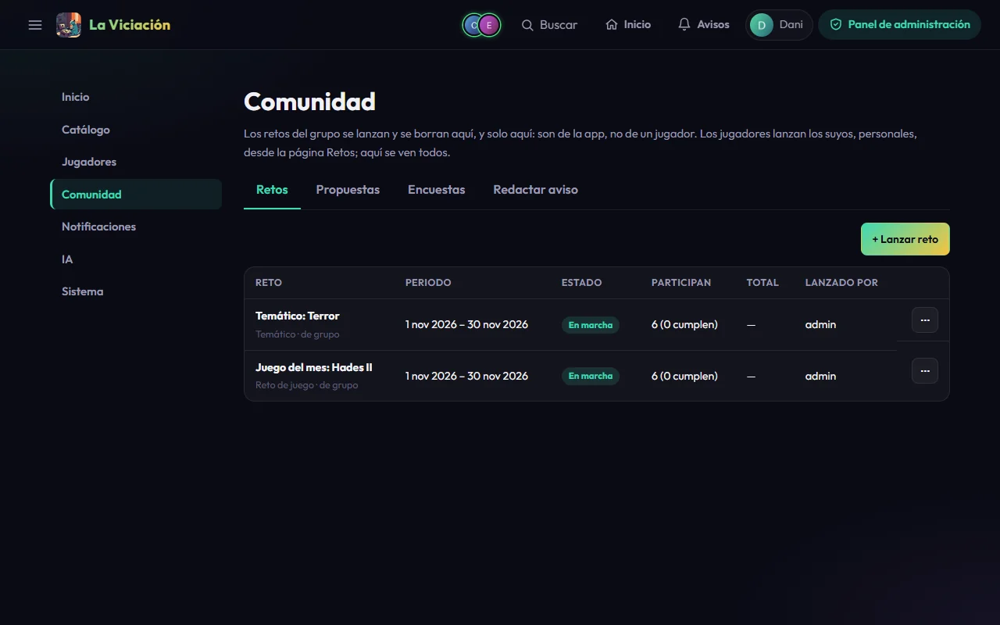
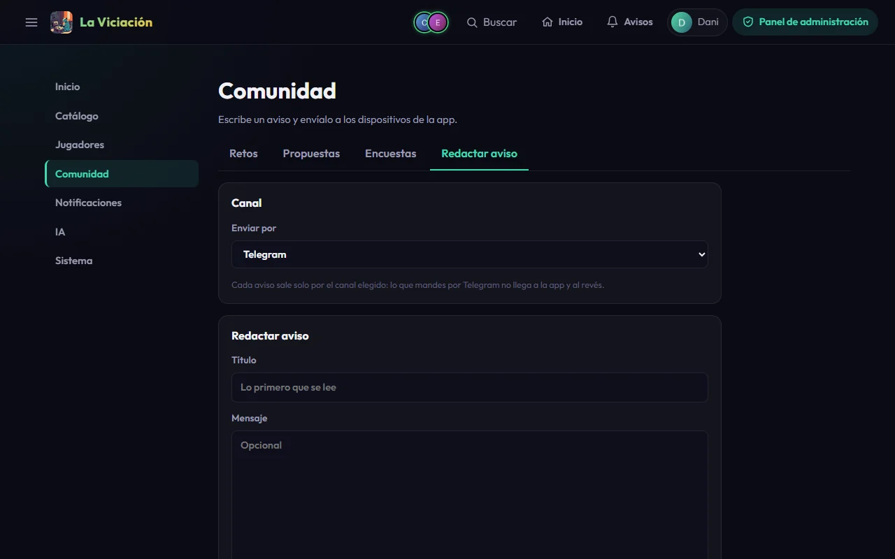
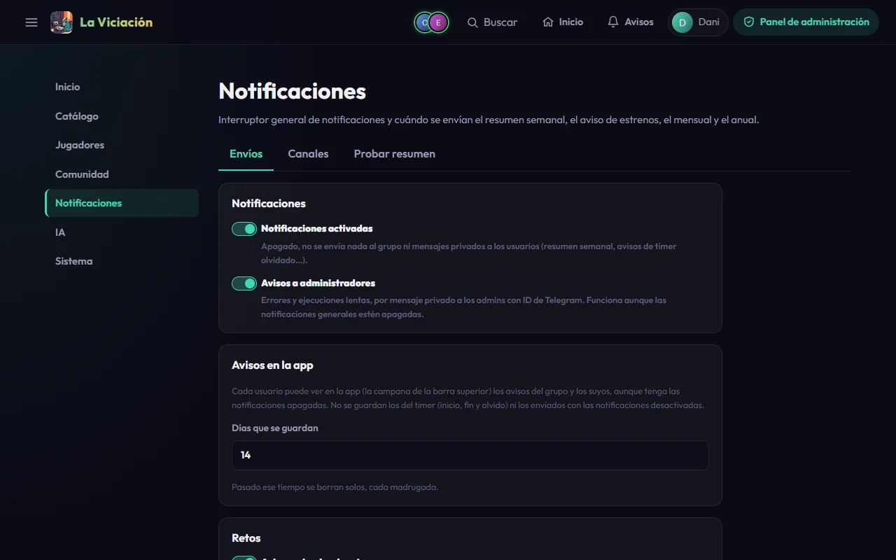
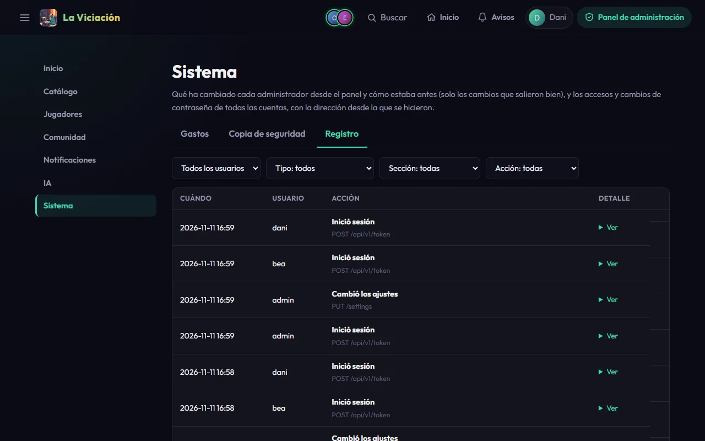

# Panel de administración

Los administradores ven en el menú lateral **Más → Panel de administración**. Cada sección tiene sus pestañas, y cada cambio que haces queda en el [registro](#sistema).

## Inicio

Un resumen de la instalación: cuántos usuarios, juegos, sesiones, timers activos y entradas de biblioteca hay; **Requiere atención** (por ejemplo, jugadores sin Telegram o juegos sin ID de IGDB, con un enlace directo para arreglarlos) y **Integraciones**, que te dice qué servicios faltan por configurar.

{ .screenshot }

## Catálogo

### Juegos

La lista de todos los juegos con búsqueda, orden y filtros. **Editar** cambia cualquier dato (nombre, desarrollador, fecha, géneros, etiquetas, portada, tiempo medio, IDs, la página y los datos de IGDB, si es un DLC y cuál es su juego base…). Un DLC puede quedar sin juego base; quitar la marca de DLC le quita también el juego base. Cada fila muestra sus **sesiones**, **jugadores** (quien lo tiene en su biblioteca) y **deseado por** (cuántos lo tienen en su lista de deseos), y una etiqueta de **uso**. Pulsar el número de **jugadores** o de **deseado por** abre la lista de quién es (con su plataforma y temporada, o desde cuándo lo desea), también de las cuentas inactivas. Para limpiar juegos huérfanos, el filtro **Uso** separa tres casos: **Sin uso (nadie lo quiere)** son los que no tienen nada que los referencie (ni sesiones, biblioteca, deseos, notas, logros, precios, retos ni DLCs) y se pueden borrar sin perder nada; **Solo deseados** no tienen sesiones ni jugadores pero alguien los espera, como un lanzamiento que aún no ha salido (la fecha lleva la etiqueta *Sin salir*): **no los borres**; y **Sin sesiones ni jugadores** junta ambos. Aquí están también las sincronizaciones con IGDB y HowLongToBeat: ver [Servicios externos](servicios.md).

### Plataformas

El catálogo de plataformas que se pueden elegir en sesiones y biblioteca. Puedes **añadir** una (su identificador sale del nombre y no cambia nunca), **renombrarla** (todo lo que la usa la sigue) y **borrar** una que nadie use. Si aún tiene sesiones o entradas, te dice cuántas.

{ .screenshot }

### Logros

Todos los logros con su estado. Desde el menú **⋯** de uno, **Quién lo tiene** abre sus concesiones. Por cada logro puedes cambiar:

- **Activo**: apagado, nadie lo gana ni se anuncia, pero lo ya ganado se conserva.
- **Secreto**: oculto para quien no lo tiene.
- **Especial** (nivel 1 plateado, 2 dorado, 3 morado): le da el aura. Es independiente de **Secreto**: un logro puede ser una cosa, las dos o ninguna.
- **Desde**: la temporada en la que empieza a contar. Los nuevos logros empiezan en 2027.
- El texto y la imagen.

### Logros concedidos (Jugadores → Logros)

Lo que ha desbloqueado cada jugador, **secretos incluidos**, en una tabla paginada que se filtra por jugador, logro, juego y temporada (también desde las acciones **Logros** de Usuarios y Juegos). **Editar** cambia la fecha en que lo consiguió y el juego, y **Revocar** lo retira sin avisar. Un jugador no puede tener el mismo logro dos veces en una temporada, así que mover uno a una temporada donde ya lo tiene se rechaza. Ojo: si el jugador sigue cumpliendo la condición, se volverá a conceder en la siguiente comprobación; corrige antes el dato que lo provocó.

{ .screenshot }

**Recalcular logros…** vuelve a calcular todos los logros de todas las temporadas a partir de las sesiones y la biblioteca, **sin avisar a nadie**. Funciona en dos pasos: una vista previa de lo que añadiría, corregiría y revocaría (puedes desmarcar cualquier cambio y solo se harán los marcados; las revocaciones de *Justo a tiempo* vienen desmarcadas) y, tras escribir `RECALCULAR`, el recálculo en segundo plano. Puedes elegir jugadores, temporadas y logros. Úsalo cuando importes historial o cuando arregles datos antiguos.

## Jugadores

- **Usuarios**: crear, editar y desactivar cuentas (ver [Cuentas y acceso](cuentas.md)) Cada fila muestra cuántas sesiones, entradas de biblioteca, notas y logros tiene, y su menú **⋯** salta a cada una de esas tablas ya filtrada por ese jugador (los juegos tienen lo mismo).
- **Sesiones**: todas las sesiones de todos, con filtros. Puedes **crear una sesión a mano** (para un timer olvidado, por ejemplo), editar el juego, la plataforma, el inicio o el fin de cualquiera, incluso de temporadas cerradas, y cerrar un timer atascado poniéndole un fin. Los cambios de un administrador no avisan al grupo.
- **Biblioteca**: las entradas de biblioteca de cada jugador, con su fecha de completado y la marca de abandonado.
- **Puntuaciones**: crear, cambiar y borrar notas de cualquier jugador.
- **Logros**: lo que ha desbloqueado cada jugador, secretos incluidos (ver más abajo).

{ .screenshot }

## Comunidad

Lo que los administradores lanzan al grupo.

- **Retos**: lanzar los retos del grupo con un único botón, **Lanzar reto**: el formulario empieza por el tipo (*Reto de juego*, *Horas entre todos* o *Reto temático*) y cambia sus campos según el que elijas, ordenados en bloques (qué, cuándo, objetivo, quién y aviso). El **periodo** se elige aparte: *un mes completo* (del día 1 al último), *una semana* (siete días desde el primer día que pongas) o *fechas libres* (desde y hasta); cada uno pide solo lo suyo. Antes de crearlo muestra un resumen y pide confirmar. Tiene un interruptor para avisar al grupo (desmarcado por defecto), otro para que sea **una competición** (se ve quién va primero) y la opción de que sea **voluntario** (hay que apuntarse), y borrar cualquiera (también los personales y los duelos).
- **Propuestas**: los retos que proponen los jugadores. **Aprobar y lanzar…** lo lanza como un reto del grupo (eliges si es voluntario y si se avisa al grupo, que sale desmarcado; antes de lanzarlo se muestra un resumen y hay que confirmar); **Rechazar…** deja una nota que ve quien lo propuso. Si el mes ya pasó no se puede aprobar: recházalo. Las que esperan respuesta salen en **Requiere atención** del Inicio.
- **Retos que se lanzan solos**: por ahora no se ofrece crearlos. Si hubiera alguno, aparece en una tabla bajo la de Retos, donde se puede parar, cambiar o borrar.
- **Encuestas**: encuestas al grupo de Telegram (**Lanzar encuesta**, que muestra un resumen y pide confirmar antes de publicarla en el grupo, solo si no hay otra abierta (hay que cerrarla antes): la pregunta, de 2 a 10 opciones, que añades una a una en una ventana, si se pueden elegir varias y una fecha límite opcional). Son **no anónimas**: aquí se ve quién votó qué (los que votan sin cuenta vinculada salen como «sin cuenta»). Se cierran con **Cerrar…** o solas al llegar la fecha límite, y al cerrar solas se avisa al grupo de la opción ganadora; al cerrar a mano el aviso sale desmarcado y, si lo marcas, se pide confirmar. Si Telegram no deja pararla, la encuesta queda cerrada aquí igualmente (ya no cuentan los votos nuevos) y se reintenta sola durante un día; mientras tanto la lista dice *Sigue abierta en Telegram* y **Cerrar en Telegram** lo prueba otra vez. Solo se puede borrar una encuesta cerrada.
- **Redactar aviso**: escribe un mensaje propio, con título (80 caracteres) y mensaje, y envíalo por **un** canal: **Telegram** (el que sale por defecto) o la **app** (push, solo texto plano y 240 caracteres); a tus dispositivos, a un jugador, al grupo o a todos. Enviar al grupo o a todos pide confirmación. El mensaje de Telegram admite hasta 3.000 caracteres y **Markdown** (`# título`, `**negrita**`, `*cursiva*`, `~~tachado~~`, `` `código` ``, `[texto](https://…)`, `- viñetas`, `1.` listas, `> citas` y `---`), pensado para contar las novedades de una release; la vista previa lo dibuja, y la bandeja de avisos de la app guarda una copia en texto plano.

{ .screenshot }

{ .screenshot }

## Notificaciones

- **Envíos**: el interruptor general de notificaciones, el de avisos a administradores, y los envíos programados: resumen semanal (día y hora), resumen mensual y resumen anual (apagados por defecto). En **Retos**: los avisos privados de retos (duelos, propuestas y resultados), avisar al grupo de cómo ha terminado un reto de grupo y permitir los recordatorios (cada jugador los activa en su perfil), con la hora de los resultados (09:30) y de los recordatorios (10:00). Los retos personales y los duelos nunca se avisan al grupo. Las propuestas nuevas llegan a la bandeja de avisos de los administradores.
- **Canales**: por dónde salen los avisos y lo que cada canal necesita, cada uno en su tarjeta. **Telegram**: el token y los chats (solo si están puestos: se configuran en el `.env`) y **Enviar mensaje de prueba al grupo**. **Avisos en la app (push)**: el interruptor, cuántos dispositivos hay suscritos, el contacto para los servicios push (lo único editable) y **Regenerar claves**. **Correo** de recuperación de contraseña, con su correo de prueba (ver [Cuentas y acceso](cuentas.md)).
- **Probar resumen**: previsualiza el resumen de cualquier mes o temporada para cualquier jugador, enseña el aviso tal como saldría (sin enviarlo) y permite enviarlo ahora solo a ti o al grupo.

{ .screenshot }

## IA

- **Avisos con IA**: el interruptor de la IA, **Probar la IA**, el proveedor, la clave, la clave de administración de OpenAI y el modelo (solo se ven: están en el `.env`) y los avisos que la usan, cada uno con su interruptor e instrucciones.
- **Chat y guía**: interruptor del asistente de la app (el botón flotante) y de la guía de cada juego, sus instrucciones y si los jugadores lo tienen disponible ahora (y, si no, por qué). Cada uno tiene su selector de proveedor («Igual que los avisos» por defecto; la guía, «Igual que el chat») y su modelo, el que elijas aquí (de la lista que da el propio proveedor en ese momento), o `<PROVEEDOR>_CHAT_AI_MODEL` y, si no, el de los avisos: su interruptor y sus instrucciones son suyos, así que apagarlo aquí no afecta a los avisos ni al revés. Incluye un botón para probar el modelo. El selector de modelo cambia sin redesplegar nada.
- **Límites**: todo lo que limita el uso de la IA, junto. **Quién asume el coste** del chat y de la guía (solo la clave del jugador, primero la del grupo y después la del jugador, o siempre la del grupo); los **límites de preguntas** (del chat: por jugador y minuto, hora y día, y del grupo entero por minuto y día; de la guía: por jugador y hora y día, y del grupo por día; 0 es sin límite; se cuentan en memoria, así que reiniciar la API los pone a cero); el **presupuesto mensual en dinero** (en dólares enteros: el del grupo y el de cada jugador por defecto; vacío es sin límite y 0 es nada de la clave del grupo), y debajo lo gastado este mes y una tabla para dar a cada jugador otro tope (con 0 ese jugador no puede usar la IA de la clave del grupo, aunque si tiene su propia clave sigue usándola). Debajo está el **monedero** de la clave del grupo: ahí se anota lo que aporta cada jugador (en dólares; una devolución o corrección es una aportación negativa), se ve cuánto ha aportado, gastado y le queda a cada uno y el total disponible (para compararlo con el saldo real de tu cuenta de OpenAI, que puedes teclear ahí mismo), y se elige desde qué día cuenta el gasto (por defecto, desde la primera aportación). Hasta la primera aportación el monedero está apagado y solo mandan los presupuestos mensuales; después, quien se queda sin saldo (0 o en negativo) no puede usar la clave del grupo hasta que se le anote otra aportación, y si tiene su propia clave sigue con ella. Las aportaciones no se editan ni se borran.
- **Uso y coste**: primero, lo que ha usado la IA de la app (cada pregunta deja una fila con sus tokens, su coste estimado y de qué tipo era, nunca su texto): por mes, jugador, función, modelo y tipo de pregunta. Después, lo que ha facturado OpenAI en el último año (lo máximo que conserva): el total, mes a mes, por concepto y, eligiendo un mes, por día. Al final, la tarjeta **Coste de la IA**: cada cuánto se actualizan los precios y cuántos días se conserva el registro. Hace falta `OPENAI_ADMIN_KEY` en el `.env` (ver [Servicios externos](servicios.md)); sin ella el panel lo dice. Los datos se guardan unos minutos en memoria (**Actualizar** vuelve a pedirlos) y no se almacena nada. Solo OpenAI: Google no ofrece el gasto por API.

## Sistema

- **Gastos**: lo que cuesta mantener la app, como tarifas con los días en que valen, para el gasto que enseña la página **Servidor**. El servidor aparece solo (con su precio de Hetzner desde el día en que se creó, y una tarifa nueva cada vez que ese precio cambia); aquí se añaden el dominio y cualquier otro gasto (**Nuevo gasto**: concepto, tipo, importe con IVA, si es al mes, al año o una sola vez, y desde qué día vale y, si acaba, hasta cuál). Un gasto anual se reparte en doce meses; uno de una sola vez cuenta entero en el mes de su fecha. Puedes corregir el histórico: por ejemplo, partir la tarifa del servidor en la fecha en que cambió de precio de verdad. Para dejar de contar algo que ya no existe, ponle fecha de fin en vez de borrarlo.
- **Copia de seguridad**: **Descargar copia (.sql.gz)** genera un volcado completo de la base de datos (usuarios, sesiones, biblioteca, logros, ajustes y fotos). Ver [Operación](operacion.md).
- **Registro**: qué ha cambiado cada administrador desde el panel, de lo más reciente a lo más antiguo, con un **Ver** que despliega cómo estaba antes y qué se envió. Se puede filtrar por usuario, tipo (cambios del panel o accesos y seguridad), sección y tipo de acción. También anota los accesos y los intentos fallidos de cualquier cuenta (y cuándo una cuenta queda bloqueada unos minutos), los cambios y recuperaciones de contraseña, los cambios del propio email o id de Telegram y los intentos de entrar al panel sin ser administrador, con la dirección y el navegador desde los que se hicieron. También anota cada vez que la IA se queda sin cupo (qué cupo, su límite y cuánto esperar), que es la forma de saber cuánto da el nivel gratuito de tu proveedor. Las contraseñas, tokens y claves nunca aparecen; lo demás que hacen los jugadores en su cuenta no se registra.

{ .screenshot }
