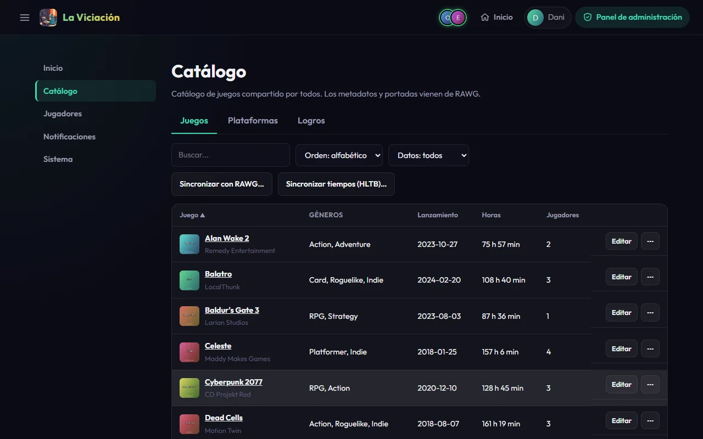
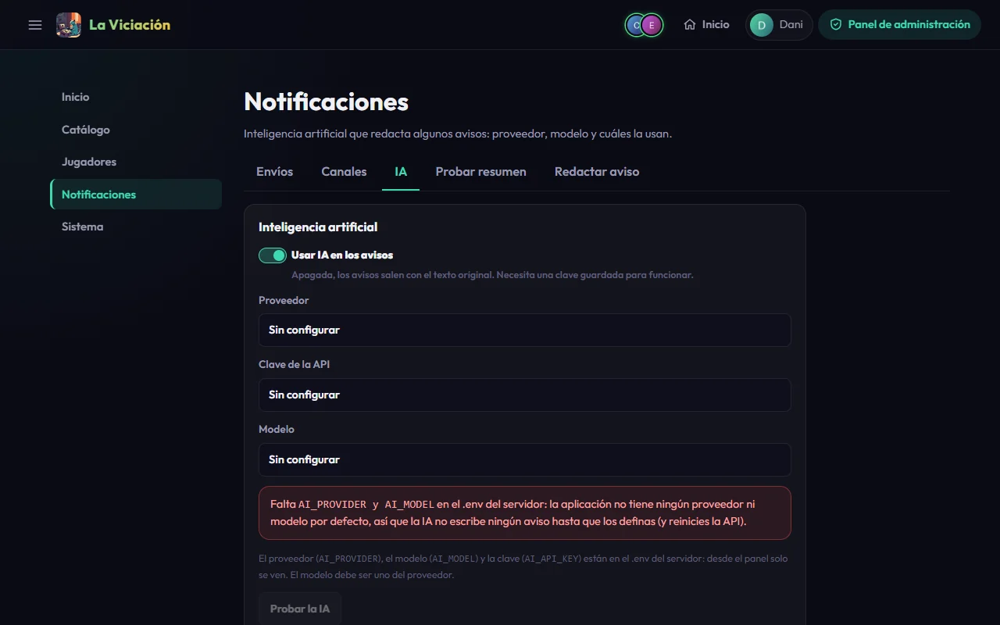

# Servicios externos

Todos son opcionales: la app arranca sin ninguno. El panel (**Inicio → Integraciones**) te dice cuáles faltan.

## RAWG: buscar juegos y portadas

[RAWG](https://rawg.io/apidocs) es el catálogo del que salen los datos de los juegos (portada, géneros, desarrollador, fecha, etiquetas).

1. Pide una clave gratuita en <https://rawg.io/apidocs>.
2. Ponla en el `.env`: `RAWG_API_KEY=tu_clave`, y `docker compose up -d`.

Sin clave, la búsqueda de juegos nuevos y las sincronizaciones no hacen nada (los juegos se pueden crear a mano, solo con el nombre).

En **Catálogo → Juegos** del panel:

- **Sincronizar con RAWG…** recorre los juegos incompletos para rellenar lo que falte. Pide confirmación, trabaja en segundo plano con una ventana de progreso y se puede cancelar.
- El filtro **Datos de RAWG** (*Incompletos*, *Sin ID de RAWG*) te dice qué juegos queda por arreglar a mano.
- **⋯ → Resincronizar (RAWG y HLTB)…** actualiza **un** juego desde las dos fuentes.

{ .screenshot }

### Tiempos de HowLongToBeat

Los tiempos para completar (la historia principal) vienen de [HowLongToBeat](https://howlongtobeat.com), **sin clave**. **Sincronizar tiempos (HLTB)…** reemplaza el tiempo de los juegos que elijas (todos, solo los que no tienen, los que tienen un tiempo increíble o los N jugados más recientemente). Cada juego tarda unos 5 segundos y la ventana lo calcula antes de aceptar. Con esos tiempos se calculan la **deuda** y algunos logros.

## IA: avisos más graciosos

La IA reescribe algunos avisos del grupo (un juego nuevo, un juego completado, cambios en los rankings…) con humor. Sin ella los avisos salen como texto normal.

Necesitas **las tres** variables en el `.env`:

```ini
AI_PROVIDER=google          # o openai
AI_API_KEY=tu_clave
AI_MODEL=gemini-3.5-flash-lite   # un modelo de ese proveedor
```

El código no trae proveedor ni modelo por defecto, y desde el panel no se pueden cambiar (solo se muestran). Se ven en **Sistema → Servicios**. Lo que sí se edita desde el panel, en **Notificaciones → IA**:

- El **interruptor** de la IA.
- Los **avisos que la usan**, cada uno con su propio interruptor y sus **instrucciones** (prompt) editables. **Restaurar las originales** vuelve a seguir las del código.
- **Probar la IA**, que le pide una frase a la configuración activa y te enseña la respuesta o por qué falló.

{ .screenshot }

### Cuánto ha gastado la IA (solo OpenAI)

OpenAI no dice por API cuánto crédito queda, pero sí cuánto se ha facturado. Para verlo en **Sistema → Uso de IA** hace falta una segunda clave, distinta de `AI_API_KEY`:

1. En platform.openai.com → Settings → Organization → **Admin keys** (solo un propietario de la organización las ve), crea una clave de administración. También sirve una clave restringida con solo el permiso de lectura de uso (`api.usage.read`), que es más segura porque no puede hacer nada más.
2. Ponla en el `.env` como `OPENAI_ADMIN_KEY=` y reinicia la API.

El panel enseña el gasto del **último año** (OpenAI no guarda más): el total, mes a mes, por concepto (modelo, entrada y salida) y, al elegir un mes, día a día. Es el gasto de **toda la organización de OpenAI**, no solo el de esta app. Con Google (Gemini) no hay nada equivalente, así que ahí no se ve. No es el saldo que queda: ese solo está en platform.openai.com → Billing.

## Chat de la app

El botón flotante de abajo a la derecha abre un asistente que responde sobre videojuegos y los datos del grupo. **Usa el mismo proveedor y la misma clave** que la IA de los avisos (`AI_PROVIDER`, `AI_API_KEY`), así que si la IA ya está configurada no hace falta nada más. Solo hay una variable propia, opcional: el modelo.

```ini
CHAT_AI_MODEL=gemini-3.5-flash   # opcional: un modelo del mismo proveedor; sin ella se usa AI_MODEL
```

Sirve para dar al chat un modelo más potente que el de los avisos (que solo reescriben frases cortas). Como las demás claves y modelos, vive solo en el `.env` y desde el panel solo se ve. Lo que se edita desde el panel, en **Sistema → Chat**, es el **interruptor** (independiente del de los avisos), las **instrucciones** y el botón **Probar el chat**; la pestaña dice si los jugadores lo tienen disponible y, si no, qué falta; el modelo que usa se ve en **Sistema → Servicios**.

## Notificaciones push

Es un segundo canal junto a Telegram, **activado por defecto** y sin nada que configurar: la API crea sus claves VAPID (un par para todo el servidor) en el primer arranque y las asocia al entorno y a la dirección pública (`ENVIRONMENT` y `PUBLIC_URL`) de esa instalación. Si copias una base de datos a otra instalación (por ejemplo, producción a tu equipo), los avisos quedan apagados allí hasta que generes claves nuevas, para no notificar a dispositivos reales. Solo necesita **HTTPS** delante de la app, y que cada jugador acepte los avisos en cada dispositivo. Si lo necesitas, **Sistema → Servicios** permite cambiar el contacto (por defecto, `SMTP_EMAIL`) o regenerar las claves (lo que desuscribe todos los dispositivos), y **Notificaciones → Canales** apagarlo.

## Open-Meteo: el tiempo y las ciudades

Los logros que dependen del tiempo (tormenta, niebla) y la búsqueda de la ciudad en el perfil usan [Open-Meteo](https://open-meteo.com), **sin clave ni cuenta**. Solo necesitan que el contenedor de la API pueda salir a internet por HTTPS. Si no responde, la búsqueda de ciudad devuelve un error y esos logros esperan a la siguiente comprobación.
