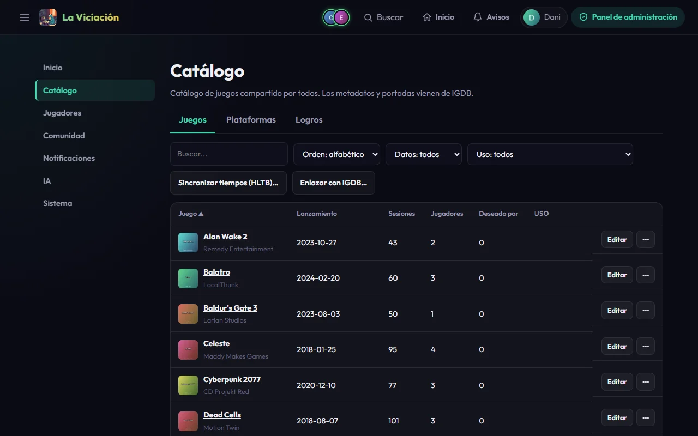
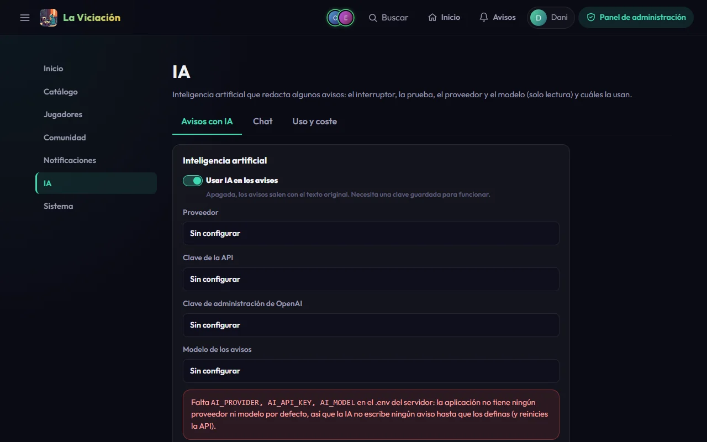

# Servicios externos

Todos son opcionales: la app arranca sin ninguno. El panel (**Inicio → Integraciones**) te dice cuáles faltan.

## IGDB: la fuente principal de los juegos

[IGDB](https://www.igdb.com/) (el catálogo de juegos de Twitch) es de donde salen los datos de los juegos: la búsqueda, la portada, los géneros, la desarrolladora, la fecha de lanzamiento **oficial** (no la de acceso anticipado ni la de una beta), los temas, las palabras clave, las franquicias y colecciones, la saga, y en la ficha el tráiler, las capturas y la nota de la crítica. **RAWG solo se usa como respaldo, si IGDB no responde o no tiene el juego, y el panel ya no lo menciona.**

1. Crea una aplicación en la [consola de desarrolladores de Twitch](https://dev.twitch.tv/console) (hace falta la verificación en dos pasos): URL de redirección `http://localhost`, categoría *Application Integration*, cliente *Confidential*.
2. Copia el **Client ID** y genera un **Client Secret** (solo se ve una vez).
3. Ponlos en el `.env`: `TWITCH_CLIENT_ID=...` y `TWITCH_CLIENT_SECRET=...`, y `docker compose up -d`.

En **Catálogo → Juegos** del panel:

- **Enlazar con IGDB…** da su id de IGDB, la dirección de su página y sus datos (temas, palabras clave, franquicias, colecciones) a los juegos que ya tienes, por tandas del tamaño que elijas. Solo enlaza cuando la coincidencia es segura (el mismo juego de Steam, o el mismo nombre con un año que cuadre); los dudosos se listan al terminar para elegir a mano. Con la casilla **Sustituir también los datos del juego**, los que se enlacen o completen en esa tanda toman de IGDB la portada, la fecha, los géneros y la desarrolladora en lugar de los que tenían.
- **Cada hora**, un aviso interno enlaza solo con IGDB los juegos añadidos hace poco, con la misma regla de coincidencia segura.
- **⋯ → Resincronizar (IGDB y HLTB)…** actualiza **un** juego desde las dos fuentes, con una ventana que muestra que está trabajando y luego el resultado de cada una.
- **Editar** deja corregir a mano la página de IGDB del juego y sus datos (temas, franquicias, colecciones).
- El filtro **Datos** (*Incompletos*, *Sin ID de IGDB*) te dice qué juegos queda por arreglar a mano.

{ .screenshot }

## RAWG: el respaldo (opcional)

[RAWG](https://rawg.io/apidocs) ya no aparece en el panel ni en las pantallas de la app: la app está pensada para funcionar **sin clave de RAWG**. Si pones una (`RAWG_API_KEY=tu_clave` en el `.env`, y `docker compose up -d`), RAWG vuelve a ser el respaldo de IGDB: busca y crea juegos cuando IGDB no responde o no los tiene, y rellena lo que falte en la ficha (saga, tráiler, capturas) de los juegos que tienen su id. Si RAWG deja de responder, la app lo deja en paz un rato en vez de insistir.

Sin IGDB ni RAWG, la búsqueda de juegos nuevos no encuentra nada (los juegos se pueden crear a mano, solo con el nombre).

### Tiempos de HowLongToBeat

Los tiempos para completar (la historia principal) vienen de [HowLongToBeat](https://howlongtobeat.com), **sin clave**. **Sincronizar tiempos (HLTB)…** reemplaza el tiempo de los juegos que elijas (todos, solo los que no tienen, los que tienen un tiempo increíble o los N jugados más recientemente). Cada juego tarda unos 5 segundos y la ventana lo calcula antes de aceptar. Con esos tiempos se calculan la **deuda** y algunos logros.

## IA: avisos más graciosos

La IA reescribe algunos avisos del grupo (un juego nuevo, un juego completado, cambios en los rankings…) con humor. Sin ella los avisos salen como texto normal.

Cada proveedor tiene sus propias variables en el `.env`, y no hay ninguna que diga cuál usar: un proveedor existe para la app cuando tiene su clave. Define las de uno, o las de los dos:

```ini
OPENAI_AI_API_KEY=tu_clave
OPENAI_AI_MODEL=gpt-4.1-mini            # el modelo que se usa mientras nadie elija otro
GOOGLE_AI_API_KEY=tu_clave
GOOGLE_AI_MODEL=gemini-3.5-flash-lite
ANTHROPIC_AI_API_KEY=tu_clave
ANTHROPIC_AI_MODEL=claude-haiku-5-5
OPENROUTER_AI_API_KEY=tu_clave
OPENROUTER_AI_MODEL=anthropic/claude-haiku-5-5
```

El código no trae ningún modelo por defecto, y las claves y los modelos por defecto no se pueden cambiar desde el panel (solo se muestran). Lo que sí se elige desde **IA → Avisos con IA**:

- El **proveedor** de los avisos, entre los que tienen clave: con los dos, un selector; con uno, es ese; con ninguno, la página dice qué variable falta. Se aplica al guardar, sin reiniciar. El chat y la guía tienen su propio selector (en **IA → Chat y guía**), que por defecto es «Igual que los avisos» y «Igual que el chat».
- El **modelo** de cada uso: el del `.env` por defecto, o uno de la lista que **consulta en ese momento el propio proveedor** (la lista cambia al cambiar de proveedor), para cambiarlo sin redesplegar. La elección es por proveedor y por uso.
- El **interruptor** de la IA.
- Los **avisos que la usan**, cada uno con su propio interruptor y sus **instrucciones** (prompt) editables. **Restaurar las originales** vuelve a seguir las del código.
- **Probar la IA**, que le pide una frase a la configuración activa y te enseña la respuesta o por qué falló.

{ .screenshot }

### Cuánto ha gastado la IA (OpenAI y Anthropic)

OpenAI no dice por API cuánto crédito queda, pero sí cuánto se ha facturado. Para verlo en **IA → Uso y coste** hace falta una segunda clave, distinta de `OPENAI_AI_API_KEY`:

1. En platform.openai.com → Settings → Organization → **Admin keys** (solo un propietario de la organización las ve), crea una clave de administración. También sirve una clave restringida con solo el permiso de lectura de uso (`api.usage.read`), que es más segura porque no puede hacer nada más.
2. Ponla en el `.env` como `OPENAI_ADMIN_KEY=` y reinicia la API.

El panel enseña el gasto del **último año** (OpenAI no guarda más): el total, mes a mes, por concepto (modelo, entrada y salida) y, al elegir un mes, día a día. Es el gasto de **toda la organización de OpenAI**, no solo el de esta app. Con Google (Gemini) no hay nada equivalente, así que ahí no se ve. No es el saldo que queda: ese solo está en platform.openai.com → Billing.

**Anthropic** tiene lo mismo, con otra clave:

1. Solo una **organización** de la consola de Anthropic puede tener claves de administración: una cuenta individual debe crear antes su organización en platform.claude.com → Settings → Organization.
2. Un administrador de la organización crea una **clave de administración** (`sk-ant-admin01-...`), distinta de `ANTHROPIC_AI_API_KEY`.
3. Ponla en el `.env` como `ANTHROPIC_ADMIN_KEY=` y reinicia la API.

Con ella, **IA → Uso y coste** enseña también lo facturado por Anthropic (por modelo y tipo de uso) y la página Servidor pasa su parte de «estimado» a «facturado». Es el gasto de toda la organización, no solo el de esta app, y no incluye el nivel Priority Tier. Anthropic no ofrece por API el saldo que queda: míralo en la consola, en Billing. Mientras no haya clave, el panel sigue enseñando la estimación de la app.

OpenRouter es al revés: no da lo facturado, pero sí lo que queda, y el monedero de **IA → Límites** lo consulta él solo con la clave de siempre.

## Estado del servidor (Hetzner Cloud)

La página **Servidor** (al pie del menú, la ven todos los jugadores) pregunta a Hetzner cómo va la máquina. Solo vale para servidores **Cloud**, no para dedicados.

1. En la consola de Hetzner Cloud → tu proyecto → **Security → API tokens**, crea un token con permiso de **solo lectura**.
2. Ponlo en el `.env` como `HETZNER_API_TOKEN=` y reinicia la API. Si el proyecto tiene más de un servidor, indica cuál con `HETZNER_SERVER_ID=` (el número que sale en la URL del servidor en la consola).

Enseña la CPU, la red y el disco (de 1 hora a 30 días) y el tráfico del mes frente al incluido. Hetzner no informa de la memoria ni del espacio de disco usados; para eso mira la sección siguiente. Añade el **gasto del mes, del año y desde el principio**. Hetzner no tiene API de facturación, así que la app apunta el precio del servidor cada vez que cambia (un aviso diario lo comprueba) y calcula los totales a partir de esas tarifas; el servidor entra solo, con el precio de hoy desde el día en que se creó, y puedes corregir o añadir tarifas en **Sistema → Gastos** (ver [Panel de administración](panel-admin.md)). Suma también el exceso de tráfico del mes en curso. No cuenta volúmenes, snapshots ni IPs extra salvo que los añadas como gasto, y no sustituye a la factura. Las métricas se guardan un minuto en memoria; las tarifas, en la base de datos.

### Memoria, disco y carga (Prometheus)

Para ver también la **memoria**, el **espacio en disco**, la **carga** y el **tiempo encendido** hace falta medirlos dentro de la máquina. Con Prometheus encendido, la **CPU** y el **disco (lectura y escritura)** también salen de él; de Hetzner quedan el estado, la red, el tráfico del mes y el gasto. El `docker-compose.yml` trae Prometheus y node-exporter, apagados por defecto. Para encenderlos:

1. Pon en el `.env` `COMPOSE_PROFILES=monitoring` y ejecuta `docker compose up -d`. Esa misma línea le dice a la API dónde está Prometheus; no hace falta nada más. (`PROMETHEUS_URL` en el `.env` solo sirve para un Prometheus que esté en otro sitio.)
2. Espera uno o dos minutos a que Prometheus recoja los primeros datos. Puedes comprobarlo desde el servidor con `docker compose exec laviciacion-prometheus wget -qO- localhost:9090/api/v1/targets`: el objetivo `node` debe decir `"health":"up"`.

Para apagarlos, quita la línea y ejecuta `docker compose up -d --remove-orphans`. Los dos contenedores viven en la red del stack y no publican ningún puerto, así que no hace falta tocar el cortafuegos del servidor. Con la monitorización encendida, si Prometheus no responde (o aún no tiene datos) la página entera muestra el error en lugar de las gráficas, para que se note enseguida.

## Chat de la app

El botón flotante de abajo a la derecha abre un asistente que responde sobre videojuegos y los datos del grupo. **Usa el mismo proveedor y la misma clave** que la IA de los avisos, así que si la IA ya está configurada no hace falta nada más. Solo hay una variable propia por proveedor, opcional: el modelo.

```ini
OPENAI_CHAT_AI_MODEL=gpt-4.1       # opcional; sin ella se usa OPENAI_AI_MODEL
GOOGLE_CHAT_AI_MODEL=gemini-3.5-flash
ANTHROPIC_CHAT_AI_MODEL=claude-sonnet-5-5
OPENROUTER_CHAT_AI_MODEL=anthropic/claude-sonnet-5-5
```

Sirve para dar al chat un modelo más potente que el de los avisos (que solo reescriben frases cortas). Las claves y los modelos por defecto viven solo en el `.env`. Lo que se edita desde el panel, en **IA → Chat y guía**, es el **interruptor** (independiente del de los avisos), las **instrucciones**, el **modelo** (de la lista que da el proveedor en ese momento) y el botón **Probar el chat**; la pestaña dice si los jugadores lo tienen disponible y, si no, qué falta.

## Notificaciones push

Es un segundo canal junto a Telegram, **activado por defecto** y sin nada que configurar: la API crea sus claves VAPID (un par para todo el servidor) en el primer arranque y las asocia al entorno y a la dirección pública (`ENVIRONMENT` y `PUBLIC_URL`) de esa instalación. Si copias una base de datos a otra instalación (por ejemplo, producción a tu equipo), los avisos quedan apagados allí hasta que generes claves nuevas, para no notificar a dispositivos reales. Solo necesita **HTTPS** delante de la app, y que cada jugador acepte los avisos en cada dispositivo. Si lo necesitas, **Notificaciones → Canales** permite cambiar el contacto (por defecto, `SMTP_EMAIL`) o regenerar las claves (lo que desuscribe todos los dispositivos), y **Notificaciones → Canales** apagarlo.

## Open-Meteo: el tiempo y las ciudades

Los logros que dependen del tiempo (tormenta, niebla) y la búsqueda de la ciudad en el perfil usan [Open-Meteo](https://open-meteo.com), **sin clave ni cuenta**. Solo necesitan que el contenedor de la API pueda salir a internet por HTTPS. Si no responde, la búsqueda de ciudad devuelve un error y esos logros esperan a la siguiente comprobación.
