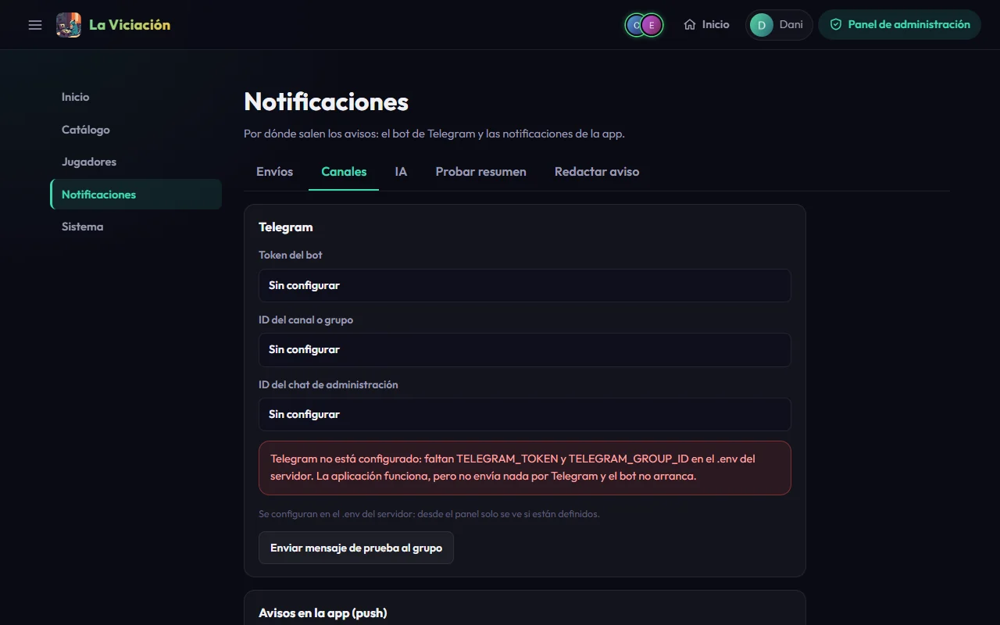

# Telegram

Telegram es el canal principal de avisos del grupo y la forma de consultar estadísticas desde el chat. Es **opcional**: sin él la app funciona igual, simplemente no envía nada por Telegram y el bot no arranca. El panel te lo recordará («Telegram no está configurado») hasta que lo conectes.

## 1. Crea el bot

1. En Telegram, abre una conversación con [@BotFather](https://t.me/BotFather) y escribe `/newbot`.
2. Elige un nombre y un usuario para el bot (acaba en `bot`).
3. BotFather te da el **token**. Guárdalo: es `TELEGRAM_TOKEN`.

## 2. Mételo en el grupo

Crea el grupo de Telegram del vuestro (o usa el que ya tengáis), añade al bot y, si quieres que pueda leer los mensajes y comandos con comodidad, hazlo administrador.

## 3. Averigua el identificador del grupo

Escribe cualquier mensaje en el grupo y abre en el navegador (cambiando `TOKEN` por el tuyo):

```text
https://api.telegram.org/botTOKEN/getUpdates
```

Busca en la respuesta `"chat":{"id":-100…}`: ese número negativo es `TELEGRAM_GROUP_ID`.

!!! warning "Haz esto con el bot parado"
    `getUpdates` falla si el bot ya está funcionando, porque los dos pelean por los mensajes. Hazlo antes de arrancar el bot, o páralo con `docker compose stop laviciacion-bot`.

Si quieres recibir los avisos de administración en privado, escribe tú al bot y repite `getUpdates`: tu identificador de usuario (`"from":{"id":…}`) es `TELEGRAM_ADMIN_CHAT_ID`.

## 4. Ponlo en el `.env` y reinicia

```ini
TELEGRAM_TOKEN=123456:ABC-el-token-de-botfather
TELEGRAM_GROUP_ID=-1001234567890
TELEGRAM_ADMIN_CHAT_ID=123456789
```

```bash
docker compose up -d
```

La API y el bot leen estas variables cada vez que las necesitan y **no las guardan en la base de datos**. Cambiarlas exige editar el `.env` y recrear los contenedores; el panel no puede cambiarlas.

!!! tip "Un bot por entorno"
    Dos servidores con el mismo token pelean por los mensajes. Usa un bot distinto para pruebas y para producción.

## 5. Revisa el panel

En **Notificaciones → Canales** ves el estado de Telegram (si el token y los identificadores están puestos, sin enseñarlos) y puedes **Enviar mensaje de prueba al grupo**.

{ .screenshot }

## Que cada jugador se vincule

Cada jugador escribe `/activate` en el grupo. El bot guarda su identificador de Telegram si su **usuario de la app coincide con su `@usuario` de Telegram** (no distingue mayúsculas) y no hay otra cuenta con ese identificador. También se puede poner o corregir el **Telegram ID** a mano desde el perfil o el panel. Ver la [guía de usuario](../guia-usuario/notificaciones.md).

Esa es la **única escritura** del bot; todo lo demás que hace es consultar.

## Qué avisos salen

Desde **Notificaciones → Envíos** (ver el [panel](panel-admin.md)) controlas el interruptor general de notificaciones, el de los avisos a administradores (independiente), el **resumen semanal** (día y hora), el **resumen mensual** y el **anual** (apagados por defecto) y otros avisos programados. Los trabajos corren dentro de la API: no necesitas cron.
