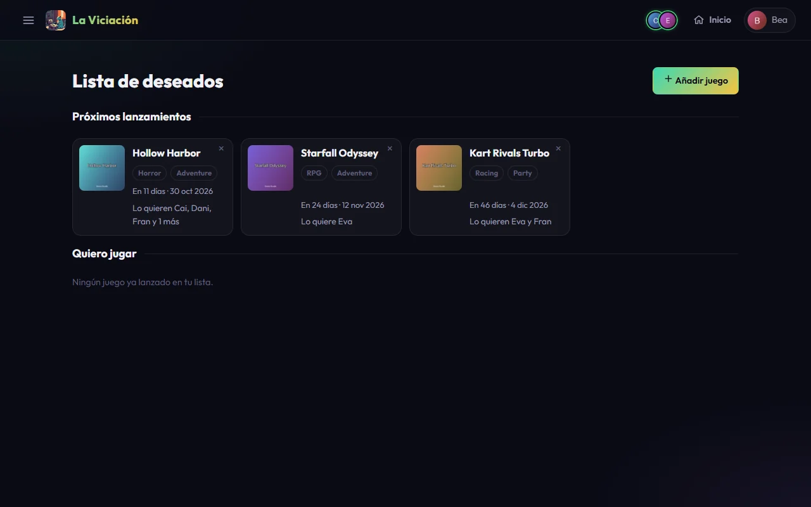
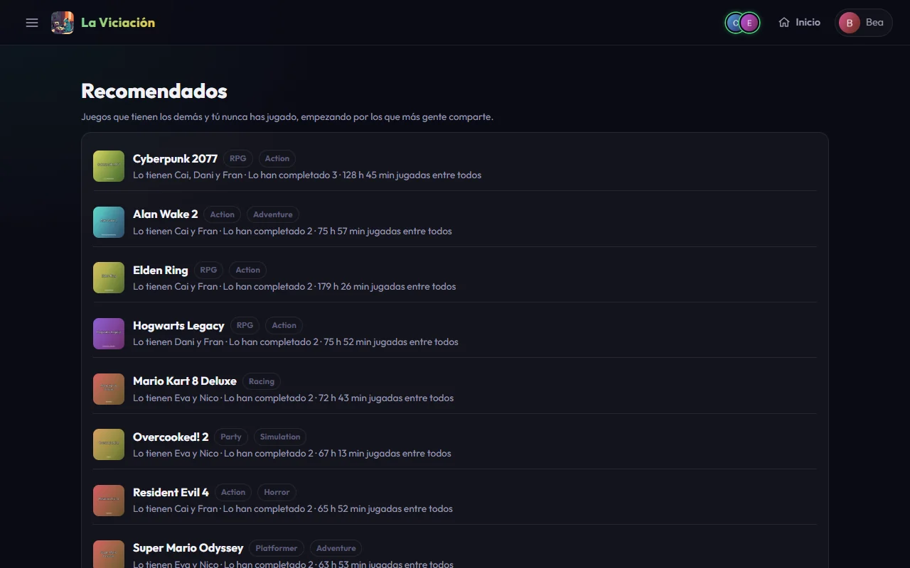
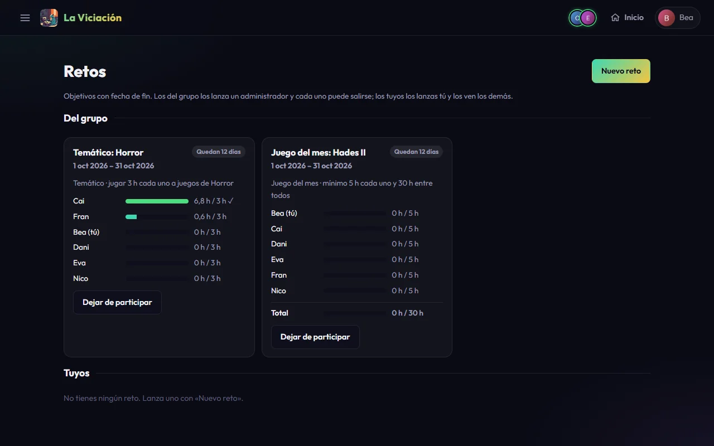

# Deseados, recomendados y retos

Tres páginas del bloque **Tú** para decidir a qué jugar y marcarte objetivos.

## Deseados

**Menú → Deseados** es tu lista de juegos que quieres jugar, incluidos los que aún no han salido, así que no necesitas otra pantalla para lo uno y lo otro.

{ .screenshot }

Tiene dos mitades:

- **Próximos lanzamientos**: juegos sin fecha de salida o con una futura, los más cercanos primero, con cuenta atrás y fecha («Sin fecha confirmada» al final).
- **Quiero jugar**: juegos ya lanzados, el último deseo primero.

Cada tarjeta dice qué otros jugadores quieren el mismo juego («Lo quieren Bea y Cai») y tiene una ✕ para quitarlo. Para añadir uno, pulsa **Añadir juego** (el mismo buscador que en Juegos) o, en la página de un juego que no tengas en tu biblioteca, **Añadir a mi lista**.

Un juego sale de la lista **solo** cuando empiezas a jugarlo. Cada día se vuelve a consultar la fecha de salida de los juegos que se esperan, y el día antes de un lanzamiento el grupo recibe un aviso con quién lo espera.

## Recomendados

**Menú → Recomendados** te propone **12 juegos** que tienen otros jugadores y tú nunca has jugado. Se escogen al azar, con más probabilidad para los que tienen más jugadores, más completados y más horas, los que encajan con los géneros que más juegas y los mejor puntuados. Cada visita, o **Otras recomendaciones**, puede darte unos distintos.

{ .screenshot }

## Retos

**Menú → Retos** reúne objetivos con fecha de inicio y de fin, a diferencia de los logros. Hay dos tipos:

{ .screenshot }

**Del grupo** (los lanza un administrador):

- **Juego del mes**: un juego, un mes, unas horas mínimas por jugador y un total entre todos. Ves una barra por jugador (verde al llegar a su mínimo) y otra para el grupo.
- **Temático**: una etiqueta de juegos (Horror, Singleplayer…), un mes y lo que tiene que hacer cada jugador: jugar un número de horas o completar al menos un juego. Cuenta cualquier juego con esa etiqueta.

Puedes **dejar de participar** y volver mientras el reto no haya terminado. Cuando el grupo alcanza el total, se avisa una vez.

**Personales** (los lanzas tú con **Nuevo reto**; los demás los ven, pero nadie recibe aviso):

- **Probar un género**: elige un género de la base de datos y juega unas horas (2 por defecto) o completa uno de esos juegos, en una semana, un mes o tres meses. Solo cuentan juegos de ese género que no tuvieras ya en tu biblioteca.
- **Bajar la deuda**: un objetivo sobre tu **deuda** (lo que te falta para terminar los juegos que has empezado), en porcentaje o en número de juegos. La app te dice, antes de lanzarlo, lo que significa («El 25 % de tu deuda son unas 10 h»).
- **Racha**: juega varios días seguidos (o varios días distintos) dentro del plazo. Un día cuenta cuando juegas al menos 10 minutos, igual que en las rachas y los logros.
- **Sesiones largas**: haz un número de sesiones de al menos los minutos que elijas, de cualquier juego.
- **Variar de género**: juega a varios géneros distintos, dedicando a cada uno las horas que pidas. El tiempo de un juego cuenta en cada uno de sus géneros.
- **Cumplir deseados**: empieza o completa juegos de tu lista de deseados. Solo cuentan los que ya estaban en ella el día que lanzas el reto; si quitas uno de la lista, deja de contar.

**Cómo vas.** Cada reto en el que participas te dice, dentro de la propia app, cómo estás: *Ya has cumplido tu parte*, *Vas bien*, *Vas por detrás del ritmo* (llevas menos de lo que toca por el tiempo que ha pasado), o, en los últimos días, *Quedan 2 días: te faltan 1,5 h*. Arriba de la página se cuenta cuántos tienes en marcha, cuántos cumplidos y cuántos con poco tiempo, y en el **Inicio** aparece una tarjeta **Mis retos** con los que están en marcha, los más urgentes primero. Es solo para ti: no se avisa a nadie.

- **Duelo de horas** y **Duelo en un juego**: retas a otro jugador a ver quién juega más (en total o a un juego concreto) durante una semana, un mes o tres meses. **Empieza al lanzarlo**; el retado puede **rechazarlo durante las primeras 48 horas** (y echarse atrás en ese tiempo). Pasado ese plazo, el duelo sigue adelante. Gana quien más horas sume y, si empatan, ganan los dos. Un duelo rechazado no cuenta para nadie. Los demás lo ven, pero nadie recibe aviso.

El administrador puede lanzar un reto del grupo (juego del mes o temático) **como competición**: además de cumplir el objetivo, se ve quién va primero, con medallas, y el puesto aparece en tu línea.

Tus retos terminados, con cómo te fue, quedan en **Perfil → Resumen → Retos**.

## Asistente (chat)

Si el administrador tiene la IA activada, verás un botón redondo abajo a la derecha en todas las pantallas. Ábrelo y pregunta lo que quieras sobre videojuegos y sobre los datos del grupo: quién lleva más horas, qué juegos de terror tenéis, cuál es tu racha, cuánto ha jugado alguien a un juego, qué has apuntado en deseados...

- Al abrirlo vacío te propone tres preguntas al azar (otras cada vez que empiezas una conversación) para que veas qué puedes preguntarle.
- Solo habla de videojuegos y de los datos de La Viciación; de otras cosas no te responderá.
- También sabe **cómo funciona la app** (temporadas, rachas, sesiones, notificaciones, quién ve qué…), qué logros te faltan (sin contarte de qué van los que aún no tienes) y cuántas preguntas te quedan en el chat.
- No guarda las conversaciones: al recargar la página o cerrar sesión empiezas de cero. El botón ↺ también empieza una nueva.
- Ve lo mismo que ves tú en el grupo (nunca la biblioteca ni los datos privados de otra persona).
- Hay un límite de preguntas por minuto, por hora y por día para cada jugador, y otro para todo el grupo, para que nadie gaste el cupo de la IA. Si te pasas, el chat te dice cuál y cuánto esperar. El administrador los ajusta.

