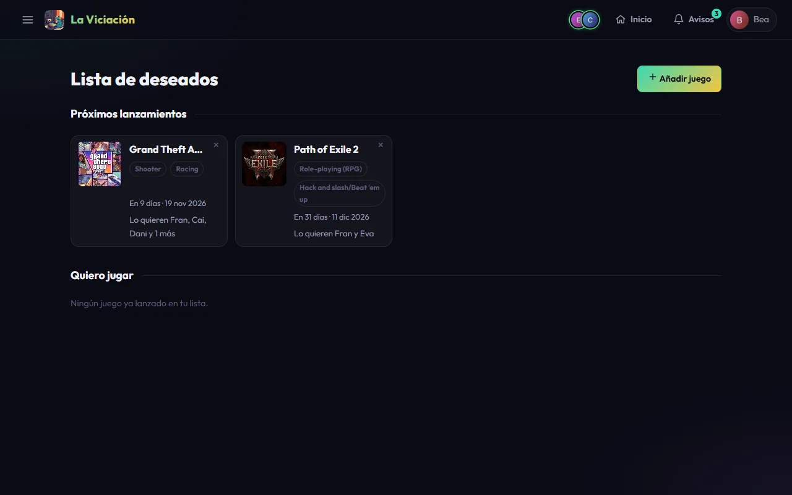
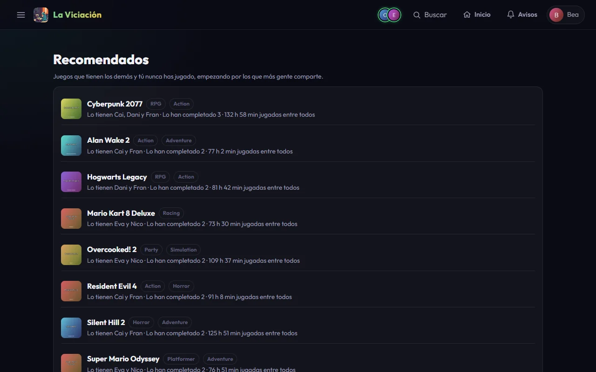

# Deseados y recomendados

Dos páginas del bloque **Tú** para decidir a qué jugar. Los objetivos con fecha están en [Retos](retos.md) y, si quieres preguntarle algo a alguien, tienes el [asistente](asistente.md).

## Deseados

**Menú → Deseados** es tu lista de juegos que quieres jugar, incluidos los que aún no han salido, así que no necesitas otra pantalla para lo uno y lo otro.

{ .screenshot }

Tiene dos mitades:

- **Próximos lanzamientos**: juegos sin fecha de salida o con una futura, los más cercanos primero, con cuenta atrás y fecha («Sin fecha confirmada» al final).
- **Quiero jugar**: juegos ya lanzados, el último deseo primero.

Cada tarjeta dice qué otros jugadores quieren el mismo juego («Lo quieren Bea y Cai») y tiene una ✕ para quitarlo. Para añadir uno, pulsa **Añadir juego** (el mismo buscador que en Juegos) o, en la página de un juego que no tengas en tu biblioteca, **Añadir a mi lista**.

Un juego se queda en la lista hasta que lo quites tú con la ✕, aunque ya lo estés jugando (por ejemplo, por un acceso anticipado): su tarjeta lleva entonces la etiqueta **Ya en tu biblioteca**, y sigue contando en el calendario y en los avisos. Cada día se vuelve a consultar la fecha de salida de los juegos que se esperan, y el grupo recibe un aviso con quién lo espera (la víspera, el mismo día o en un resumen semanal, según la configuración), además del tuyo, privado, el día que sale.

## Recomendados

**Menú → Recomendados** te propone **12 juegos** que tienen otros jugadores y tú nunca has jugado. Se escogen al azar, favoreciendo los que encajan contigo. Cada visita, o **Otras recomendaciones**, puede darte unos distintos.

{ .screenshot }
