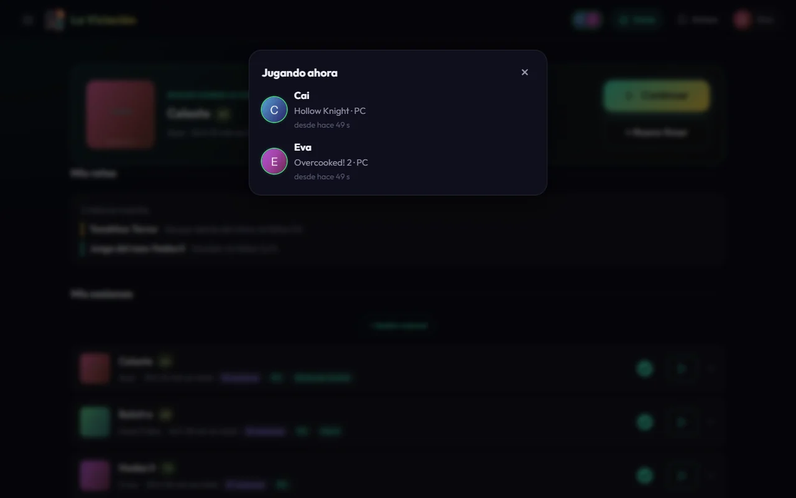
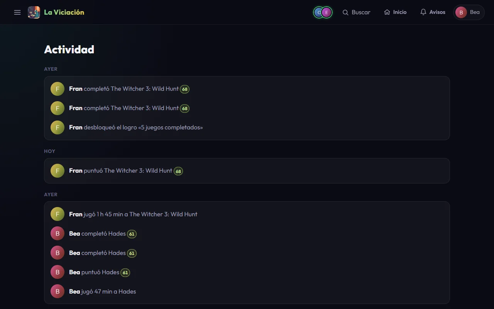
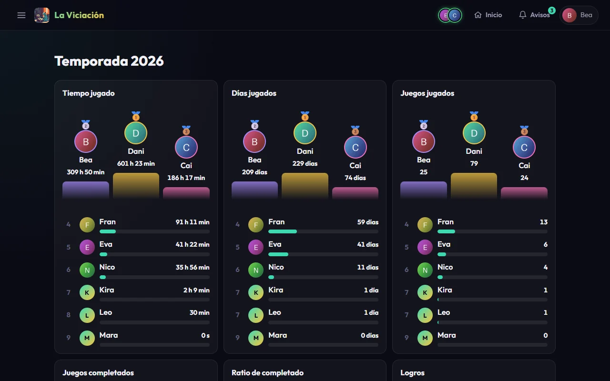
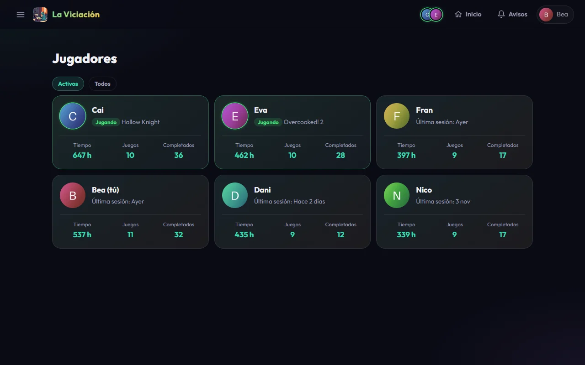
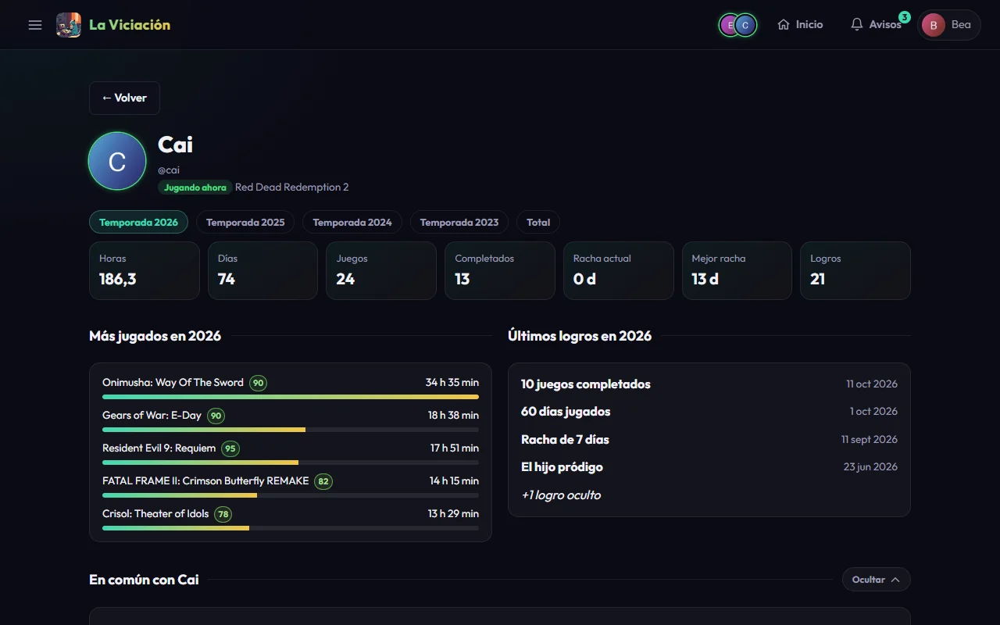

# El grupo

Las páginas del grupo: lo que está en **Principal** y **Grupo** del menú es del grupo entero. Los juegos, la biblioteca y el calendario tienen su propia página: [Juegos, biblioteca y calendario](juegos.md). Aquí: ves lo que hacen los demás y ellos ven lo tuyo (nunca tu email, tu Telegram ni tus ajustes).

## Quién está jugando ahora

En la barra superior aparece un grupito de avatares cuando alguien tiene un timer en marcha. Pulsa para ver quién, a qué, en qué plataforma y desde hace cuánto. Si varios juegan al mismo juego aparecen juntos («Cai, Eva y tú estáis jugando a…»).

{ .screenshot }

## Actividad

**Menú → Actividad** es el muro del grupo: cada sesión jugada, cada juego empezado por primera vez, cada juego completado, cada nota y cada logro, de lo más reciente a lo más antiguo y agrupado por días.

{ .screenshot }

## Temporada

{ .screenshot }

**Menú → Temporada** (el primero de Grupo) enseña los rankings de la **temporada en curso**, solo con los jugadores activos. No tiene selector: siempre es la de este año. Cada ranking es un **podio** con los tres primeros (el segundo a la izquierda del primero) y, debajo, el resto hasta el décimo en barras; todos los jugadores activos salen en todos los rankings, con un 0 si no tienen nada, y quien empata comparte el puesto. Los rankings son:

- **Tiempo jugado**, **Días jugados** y **Juegos jugados**.
- **Juegos completados** y **Ratio de completado** (qué parte de los juegos de tu biblioteca de la temporada has completado, en porcentaje).
- **Logros**.
- **Mejor racha** y **Racha actual**, en días seguidos.
- **Juegos más jugados**, con la portada de cada juego (o un mando si no la tiene); el nombre lleva a su página.

Los nombres de los jugadores no enlazan a su perfil: para eso está [Jugadores](#jugadores).

## Jugadores

**Menú → Jugadores** lista a los miembros con su foto, sus horas, sus juegos y completados, y qué están jugando ahora. Los que están jugando van primero. Por defecto solo ves a los activos; el filtro **Activos / Todos** añade las cuentas desactivadas.

{ .screenshot }

Al pulsar uno ves **su página**: sus cifras por temporada, sus juegos más jugados con sus notas y sus últimos logros. En la de otro jugador, al final, la sección plegable **En común con…** trae la **afinidad contigo**, un porcentaje que dice cuánto se parecen vuestros gustos: cuánto coincidís en los juegos que tenéis, en las notas que les habéis puesto y en los géneros a los que dedicáis tiempo. Con pocos juegos en común dice que hay pocos datos. Debajo separa los juegos que **tenéis los dos** (con las horas, si lo completó y la nota de cada uno), los que **solo tienes tú** y los que **solo tiene él o ella**, cada lista del más jugado al menos. Los logros que se listan en una página de jugador son los cinco últimos.

{ .screenshot }

## Servidor

**Menú → Servidor** enseña cómo va la máquina en la que corre la app, para que cualquiera del grupo lo vea: el estado de la máquina en la que corre la app y lo que cuesta mantenerla. Lo que no esté disponible, la página lo dice. Nunca enseña la dirección del servidor.
