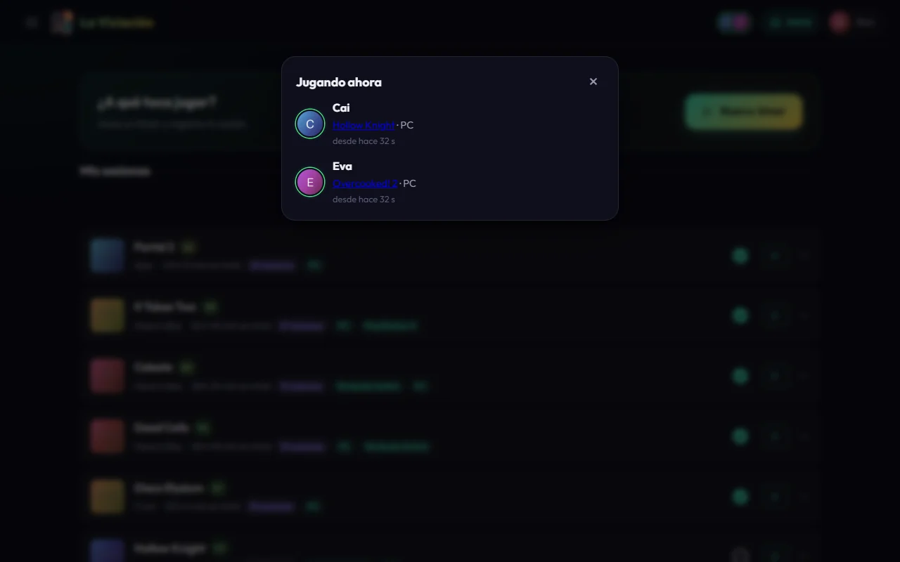
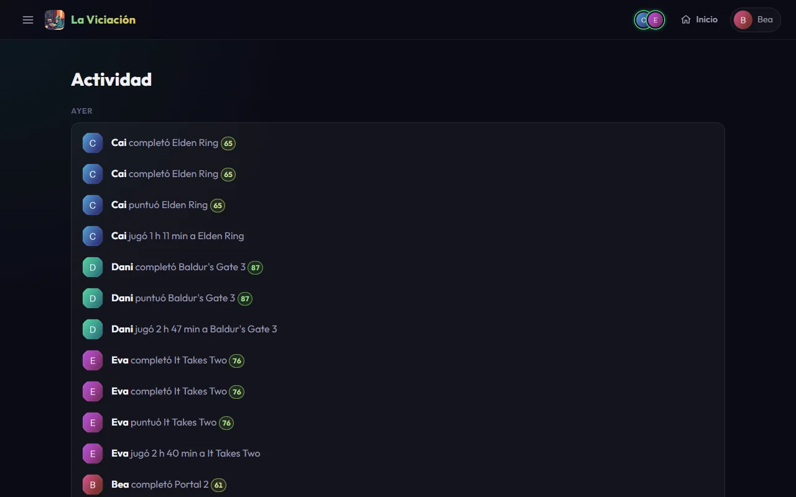
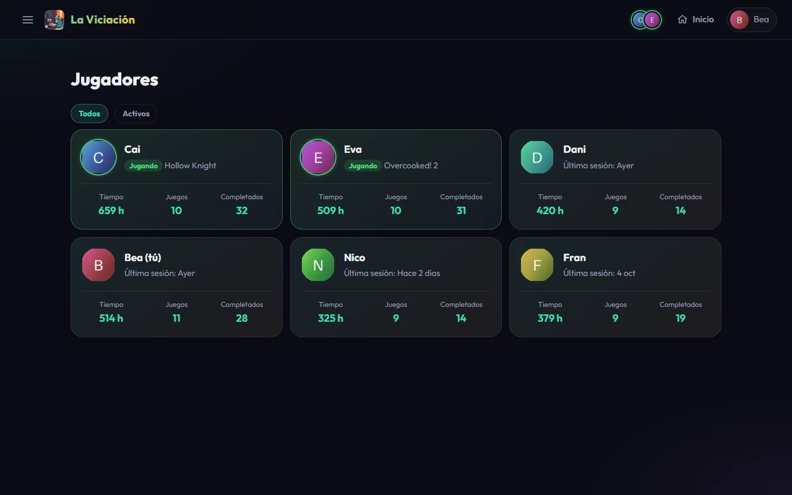
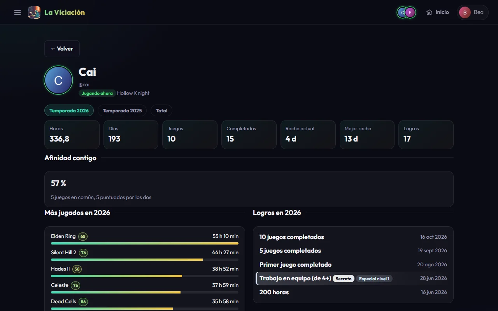
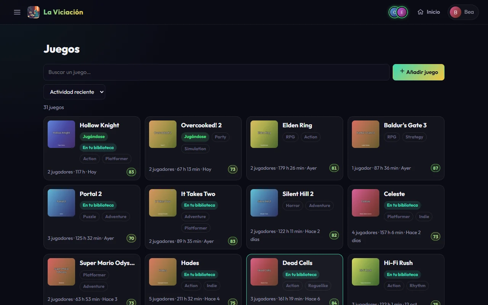
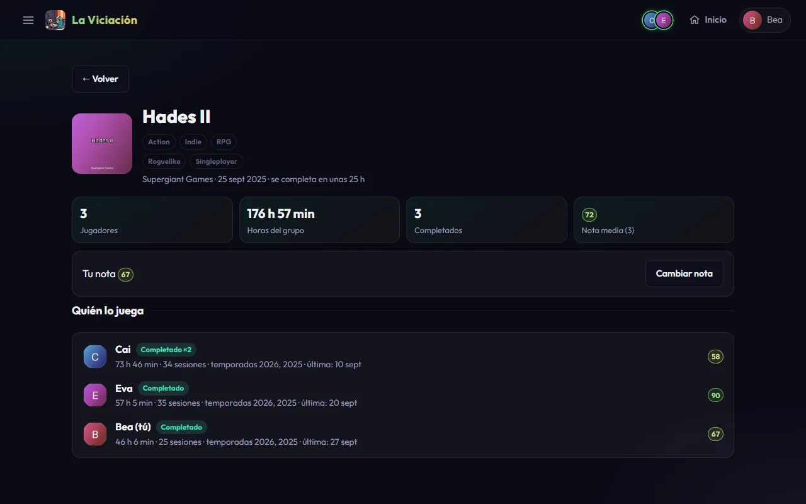
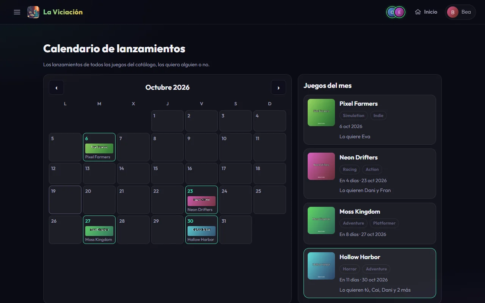

# El grupo

Todo lo que está en **Principal** y **Explorar** del menú es del grupo entero: ves lo que hacen los demás y ellos ven lo tuyo (nunca tu email, tu Telegram ni tus ajustes).

## Quién está jugando ahora

En la barra superior aparece un grupito de avatares con aura verde cuando alguien tiene un timer en marcha. Pulsa para ver quién, a qué, en qué plataforma y desde hace cuánto. Si varios juegan al mismo juego aparecen juntos («Cai, Eva y tú estáis jugando a…»).

{ .screenshot }

Un timer de más de 6 horas se muestra atenuado con «¿Un timer olvidado?» y no cuenta para el aviso.

## Actividad

**Menú → Actividad** es el muro del grupo: cada sesión jugada, cada juego empezado por primera vez, cada juego completado, cada nota y cada logro, de lo más reciente a lo más antiguo y agrupado por días.

{ .screenshot }

## Jugadores

**Menú → Jugadores** lista a los miembros con su foto, sus horas, sus juegos y completados, y qué están jugando ahora. Los que están jugando van primero. Por defecto solo ves a los activos; el filtro **Activos / Todos** añade las cuentas desactivadas.

{ .screenshot }

Al pulsar uno ves **su página**: sus cifras por temporada, sus juegos más jugados con sus notas y sus últimos logros. En la de otro jugador aparece también la **afinidad contigo**, un porcentaje que dice cuánto se parecen vuestros gustos: juegos en común (50 %), notas parecidas en los juegos que ambos habéis puntuado (30 %) y el tiempo que dedicáis a los mismos géneros (20 %). Con menos de 3 juegos en común dice que hay pocos datos. Debajo, **Tu biblioteca y la de ese jugador** separa los juegos que **tenéis los dos** (con las horas, si lo completó y la nota de cada uno), los que **solo tienes tú** y los que **solo tiene él o ella**, cada lista del más jugado al menos.

{ .screenshot }

## Juegos

**Menú → Juegos** es el catálogo compartido, en tarjetas con la portada, los géneros, si lo tienes en tu biblioteca, si alguien lo está jugando, cuántos jugadores lo tienen, las horas del grupo y la nota media.

{ .screenshot }

Puedes buscar por nombre, ordenar (actividad reciente, más jugados, mejor nota, más jugadores, fecha de lanzamiento, nombre) y filtrar por género o por lo que tienes tú. **Añadir juego** busca en RAWG y lleva a la página del juego recién creado.

Al pulsar un juego abres **su página**: portada, géneros, desarrollador, fecha de lanzamiento, tiempo medio para completarlo, las cifras del grupo, tu nota (que puedes poner o cambiar ahí mismo) y la lista de quién lo tiene con sus horas, completados y notas. Si el juego es de una saga, la tarjeta **Saga**, al final de la página, lista las entregas de la más reciente a la más antigua con lo que tienes de cada una (completada, en tu biblioteca o sin tener), cuántos jugadores la tienen y cuál es la **siguiente** que te falta; los datos vienen de RAWG, así que si no responde la tarjeta no sale. Se puede plegar pulsando su título, y el navegador lo recuerda. Si ya lo has jugado, una tarjeta compara **tu ritmo**: lo que tardaste (o llevas) frente a lo que ha tardado el resto del grupo en completarlo y frente al tiempo medio de HowLongToBeat. Si es un DLC o una expansión lo indica con la marca **DLC** y enlaza al juego base.

{ .screenshot }

!!! info "El tiempo medio para completar"
    Sale de [HowLongToBeat](https://howlongtobeat.com) (la historia principal). Con él se calcula la **deuda**: cuánto te falta por jugar de los juegos que has empezado y no has terminado.

## Biblioteca del grupo

**Menú → Biblioteca del grupo** junta las bibliotecas de todos: cuántos juegos distintos hay, cuántos jugadores y cuántas horas, y cinco listas para curiosear:

- **Joyas ocultas**: juegos que tienen como mucho dos jugadores y a los que han dado una nota media de 80 o más.
- **El cementerio**: juegos que alguien ha abandonado y no ha vuelto a tocar, con quién los dejó.
- **Rarezas**: juegos que solo tiene una persona, los más jugados primero.
- **Sin tocar**: juegos que alguien tiene y que nadie ha jugado nunca.
- **Por género** y **por plataforma**: cuántos juegos de las bibliotecas hay de cada género y de cada plataforma.

Cada juego enlaza a su página. Arriba hay una fila de **botones**, uno por sección, que te lleva directo a ella (y la abre si estaba plegada), y cada sección se puede **plegar** pulsando su título; el navegador recuerda lo que has plegado.

## Calendario

**Menú → Calendario** pone en un mes (empezando en lunes) **todos los juegos del catálogo con fecha de lanzamiento**, los hayan jugado o no. Pulsa un día para ir al juego; el panel **Juegos del mes** los lista con quién quiere cada uno. Los juegos sin fecha confirmada que alguien desea aparecen aparte, y el botón **Hoy** te devuelve al mes en curso.

{ .screenshot }
