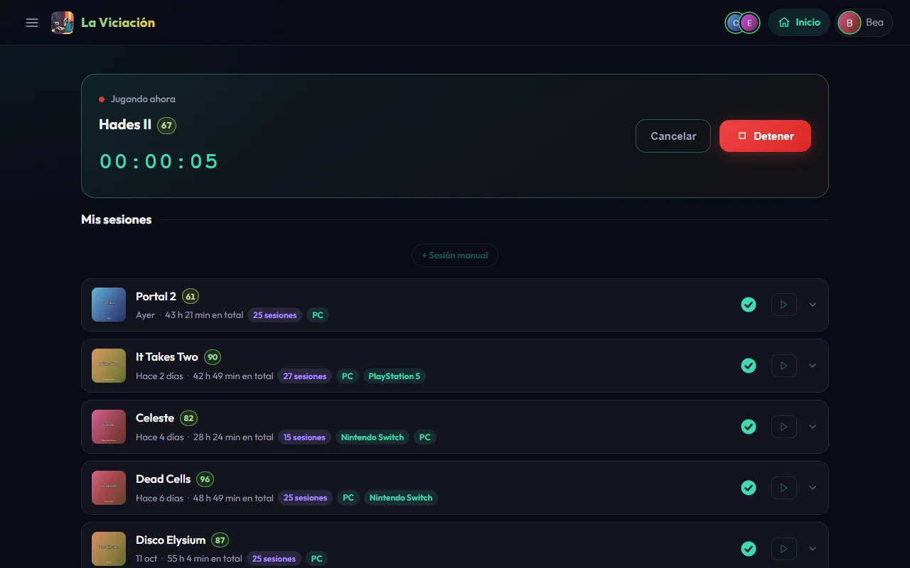

# Guía de usuario

La Viciación es la app del grupo para llevar la cuenta de **cuánto y a qué jugáis**. Tú pones un cronómetro cuando te sientas a jugar (o apuntas la sesión a mano después) y la app se encarga del resto: tu biblioteca, los rankings del grupo, las rachas, los logros y las recomendaciones.

{ .screenshot }

## Lo que necesitas saber

- **No hay registro público.** Tu cuenta la crea un administrador del grupo y te da tu usuario y contraseña. Puedes cambiarla desde tu perfil.
- **Todo sale de tus sesiones.** Las horas, los rankings, las rachas y los logros se calculan a partir de ellas. Si corriges una sesión, todo se recalcula.
- **Cada año es una temporada.** Cada 1 de enero se empieza de cero, pero el historial se queda y puedes consultar cualquier temporada anterior.

## Por dónde seguir

- :material-rocket-launch: **[Primeros pasos](primeros-pasos.md)**

    Entrar, moverte por la app e instalarla en el móvil.

- :material-timer-outline: **[Timers y sesiones](sesiones.md)**

    Cómo registrar lo que juegas, completar juegos y puntuarlos.

- :material-account-circle: **[Tu perfil](perfil.md)**

    Tus cifras por temporada, tu biblioteca y tus ajustes.

- :material-account-group: **[El grupo](grupo.md)**

    Actividad, jugadores, catálogo de juegos y calendario.

- :material-trophy: **[Logros](logros.md)**

    Qué se puede conseguir, los secretos y los especiales.

- :material-star-circle: **[Resumen e historia](resumen.md)**

    El «Wrapped» mensual y anual del grupo.

- :material-heart: **[Deseados, recomendados y retos](descubrir.md)**

    Qué jugar a continuación y objetivos con fecha.

- :material-bell: **[Notificaciones y Telegram](notificaciones.md)**

    Avisos en el móvil y el bot del grupo.

¿Algo no cuadra? Mira las [preguntas frecuentes](preguntas-frecuentes.md).
