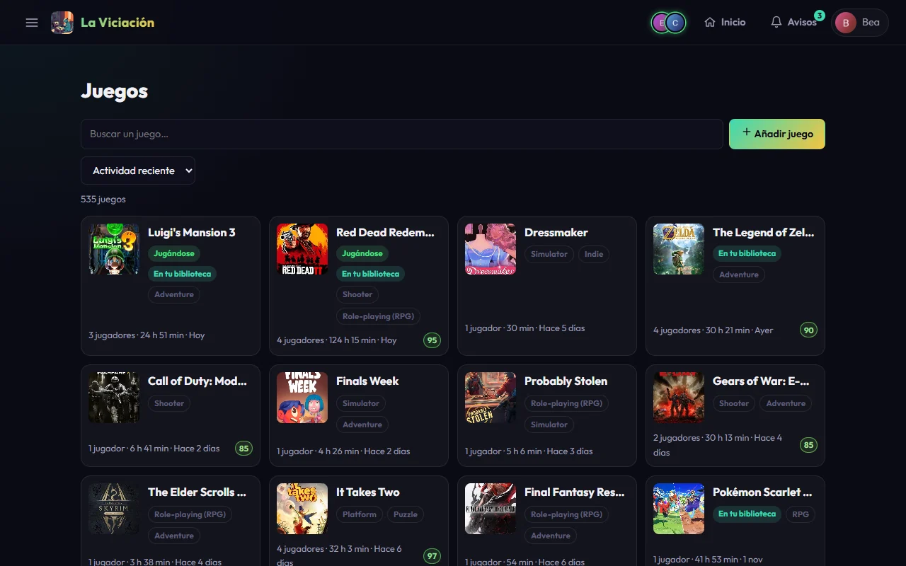
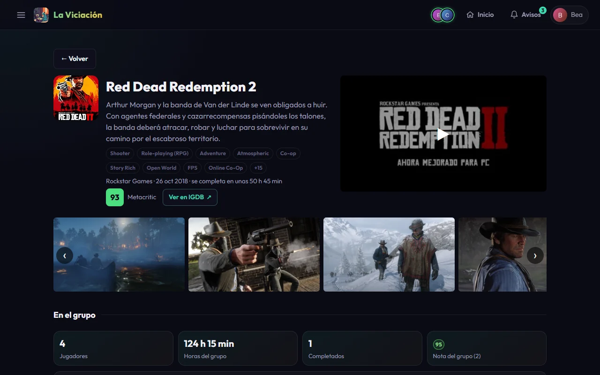
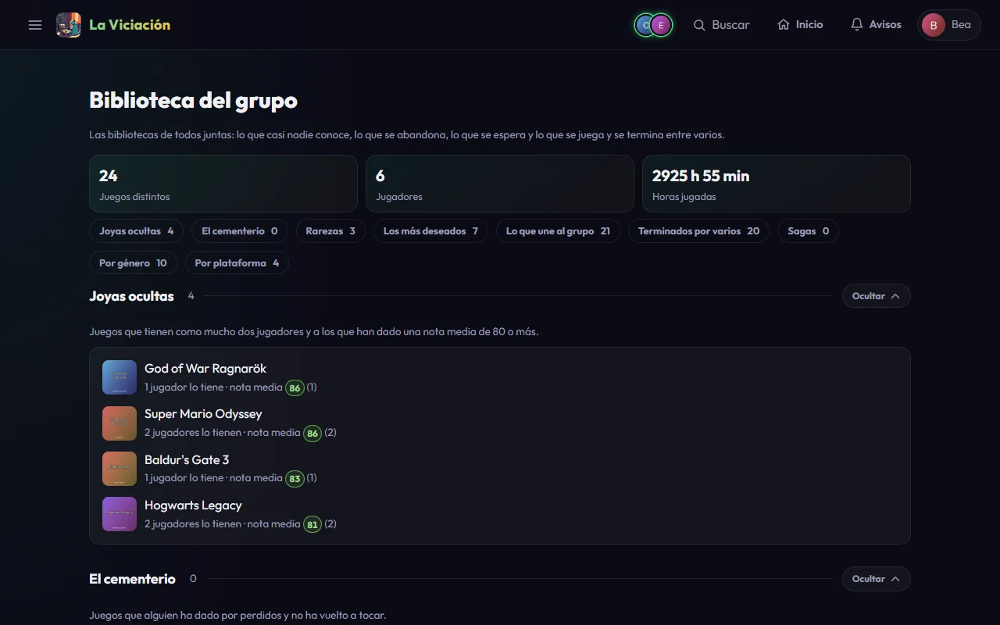
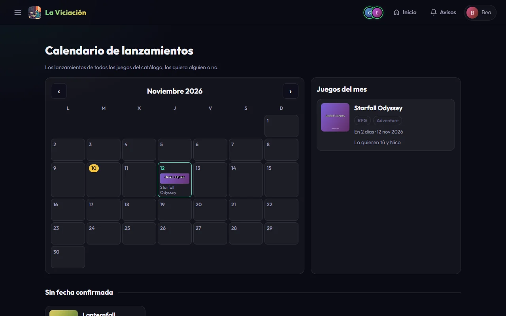

# Juegos, biblioteca y calendario

Las páginas de **Juegos** del menú que giran en torno a los juegos: el catálogo compartido (**Juegos**), las bibliotecas de todos juntas (**Biblioteca**) y el **Calendario** de lanzamientos. Lo que haces con tus propios juegos está en [Tu perfil](perfil.md) y en [Inicio](sesiones.md).

## Juegos

**Menú → Juegos** es el catálogo compartido, en tarjetas con la portada, los géneros, si lo tienes en tu biblioteca, si alguien lo está jugando, cuántos jugadores lo tienen, las horas del grupo y la nota media.

{ .screenshot }

Puedes buscar por nombre (según escribes), **ordenar** (*Actividad reciente*, *Más jugados*, *Mejor valorados*, *Más jugadores*, *Fecha de salida*, *Nombre*) y filtrar por **género**, por **tu biblioteca** (*Los que tengo* / *Los que no tengo*) y con los botones *Jugándose ahora*, *Con jugadores*, *Completados por mí* y *Puntuados por mí*, que se pueden combinar. Debajo del buscador pone cuántos juegos coinciden y **Mostrar más** carga los siguientes. Cada tarjeta lleva etiquetas: **Jugándose** (alguien tiene un timer en marcha), **DLC**, **En tu biblioteca** y **En tu lista** (de deseados). **Añadir juego** busca en IGDB (admite el nombre a medias, y los números romanos) y lleva a la página del juego recién creado.

Al pulsar un juego abres **su página**: portada, géneros, desarrollador, fecha de lanzamiento, tiempo medio para completarlo, las cifras del grupo, tu nota (que puedes poner o cambiar ahí mismo) y la lista de **Quién lo juega** con sus horas, sesiones, temporadas, completados (y cuántas veces, si más de una), notas y las etiquetas *Jugando ahora* e *Inactivo*. Si no lo tienes en tu biblioteca, la página te deja **Añadir a mi lista** (o **Quitar de mi lista**) de deseados; arriba, **← Volver** te devuelve a donde estabas. Si el juego es de una saga, la tarjeta **Saga** (a la derecha de «Quién lo juega» en una pantalla ancha, debajo en el móvil) lista las entregas de la más reciente a la más antigua con lo que tienes de cada una (completada, en tu biblioteca o sin tener), cuántos jugadores la tienen y cuál es la **siguiente** que te falta; los datos vienen de IGDB, así que si no responde la tarjeta no sale. En el móvil se puede plegar pulsando su título; en una pantalla ancha va siempre abierta. Si ya lo has jugado, una tarjeta compara **tu ritmo**: lo que tardaste (o llevas) frente a lo que ha tardado el resto del grupo en completarlo y frente al tiempo medio de HowLongToBeat. Si es un DLC o una expansión lo indica con la marca **DLC** y enlaza al juego base.

Si IGDB o Steam conocen el juego, bajo el título aparecen unos datos de fuera del grupo: la **nota de la crítica** y la de los **usuarios** de IGDB y la **clasificación por edades**, en una fila junto al botón **Ver en IGDB**. La **descripción** va justo bajo el nombre (en español si Steam la tiene; si no, la de IGDB, en inglés; se recorta y se amplía al tocarla), seguida del **editor** y de las **plataformas** en las que salió el juego (en pastillas pequeñas), y una tarjeta **Multimedia** trae el **tráiler** (no se descarga hasta que le das al play) y las **capturas** en un carrusel. En una pantalla ancha el tráiler está a la derecha de la cabecera y las capturas debajo, a todo el ancho; en el móvil es un bloque bajo la cabecera, abierto, que puedes ocultar con su botón. Las etiquetas del juego se limitan a las 6 primeras, con un botón **+N** para ver el resto. Solo sale lo que haya: un juego que ni Steam ni IGDB conocen, como muchos de Nintendo, no tiene estos datos, y si esas páginas fallan simplemente no aparecen. Nada de esto se guarda en La Viciación.

La página tiene dos mitades, separadas por un título: arriba, **lo que dice el mundo** del juego (descripción, notas, tráiler) y, bajo **En el grupo**, **lo nuestro**: las cifras del grupo, tu nota, tu ritmo, quién lo juega y la saga. La media que han puesto los jugadores se llama **Nota del grupo**, para no confundirla con las de IGDB.

{ .screenshot }

!!! info "El tiempo medio para completar"
    Sale de [HowLongToBeat](https://howlongtobeat.com) (la historia principal). Con él se calcula la **deuda**: cuánto te falta por jugar de los juegos que has empezado y no has terminado.

## Biblioteca del grupo

{ .screenshot }

**Menú → Biblioteca** junta las bibliotecas de todos: cuántos juegos distintos hay, cuántos jugadores y cuántas horas, y nueve secciones para curiosear (cada lista enseña los 10 primeros):

- **Joyas ocultas**: juegos que tienen pocos jugadores y a los que han dado muy buena nota.
- **El cementerio**: juegos que alguien ha abandonado y no ha vuelto a tocar, con quién los dejó.
- **Rarezas**: juegos que solo tiene una persona, los más jugados primero.
- **Los más deseados**: lo que más jugadores activos tienen en su lista de deseos, con quién lo desea y cuándo sale.
- **Lo que une al grupo**: juegos que dos o más jugadores han jugado en la misma temporada.
- **Terminados por varios**: juegos que han completado dos o más jugadores, cuántos de los que lo tienen lo han terminado y lo que han tardado de media.
- **Sagas**: franquicias con al menos dos juegos en las bibliotecas del grupo (los datos de franquicia vienen de IGDB, así que un juego sin ellos no cuenta), con cuántos juegos, jugadores y horas suman.
- **Por género** y **por plataforma**: cuántos juegos de las bibliotecas hay de cada género y de cada plataforma.

Cada juego enlaza a su página. Arriba hay una fila de **botones**, uno por sección, que te lleva directo a ella (y la abre si estaba plegada), y cada sección se puede **plegar** pulsando su título.

## Calendario

**Menú → Calendario** pone en un mes (empezando en lunes) **todos los juegos del catálogo con fecha de lanzamiento**, los hayan jugado o no. Pulsa un día para ver sus juegos en una ventana y entrar en cualquiera; el panel **Juegos del mes** los lista con quién quiere cada uno. Los juegos sin fecha confirmada que alguien desea aparecen aparte, y las flechas ‹ y › cambian de mes y el botón **Hoy** te devuelve al mes en curso (solo sale si estás en otro).

{ .screenshot }
