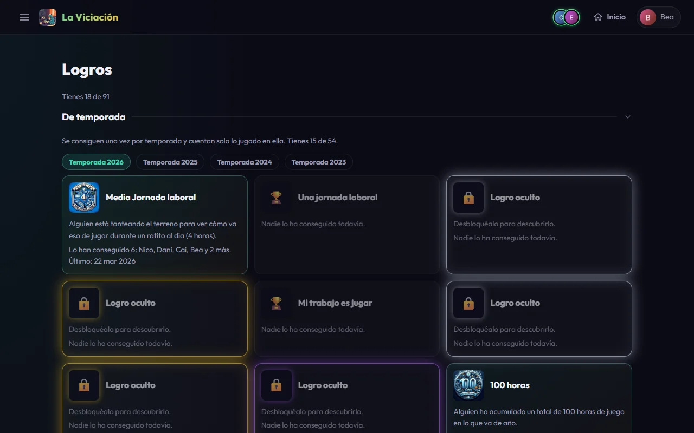

# Logros

Los logros se desbloquean **solos** al jugar (nunca los pides tú) y se anuncian al grupo. La mayoría se consiguen **una vez por temporada** y se fechan el día en que los conseguiste.

{ .screenshot }

## La página de logros

**Menú → Logros** tiene dos bloques, cada uno con su «Tienes X de Y»:

- **De temporada**: se consiguen una vez al año y cuentan solo lo jugado en esa temporada. Hay una pastilla **Resumen**, que junta todas las temporadas (cada logro una vez, entero si lo has conseguido, con las temporadas en que lo hiciste), y una pastilla por temporada (la en curso por defecto) y cada una muestra quién del grupo lo consiguió *en ese año* y, en la temporada actual, cuánto te falta.
- **Lifetime** («de por vida»): cuentan todo tu historial y se consiguen **una sola vez**.

Cada tarjeta muestra el logro, su descripción y quién lo tiene. Los que aún no tienes aparecen **atenuados y solo con el nombre**: hay que averiguar de qué van. Si todavía no los has desbloqueado, no ves ni la descripción ni la imagen.

### Barras de progreso

Los que se acumulan (horas totales, días jugados, juegos jugados, juegos completados, horas en un solo juego y la racha actual) muestran una barra, por ejemplo «35 / 100». Los que dependen de un momento concreto (jugar a ciertas horas, una fecha…) no tienen barra.

### Logros de los retos

Hay logros **lifetime** por cumplir [retos](descubrir.md#retos) (uno cuenta cuando ha terminado y has llegado a tu parte): el primero, 5 y 15 retos **del grupo** cumplidos (los personales y los duelos no suman aquí), uno de **cada tipo personal** (*Todoterreno*) y un reto **de grupo** en el que cumples tu parte y el grupo llega al total (*Misión cumplida entre todos*). Se fechan el día en que acabó el reto y se consiguen en la primera comprobación después de su final, por ejemplo al terminar tu siguiente sesión, nunca mientras el reto sigue en marcha. Solo cuentan los retos que empezaron en 2027 o después, y los duelos no cuentan por ahora.

## Secretos y especiales

- **Logro oculto**: algunos no enseñan nada hasta que los consigues, ni título, ni descripción, ni imagen. Cuando alguien desbloquea uno, al grupo solo le llega «*Fulano* ha desbloqueado un logro oculto» (por Telegram, por aviso push, en los Avisos y en la Actividad, también para quien lo tiene); se dice quién lo ha sacado, pero no cuál es. El protagonista recibe el aviso completo en privado. En la lista de logros, quien no lo tiene solo ve cuántos lo han conseguido; los nombres los ven los que ya lo han desbloqueado. Un oculto **de temporada** solo se ve entero en la temporada en que lo conseguiste (o en la pestaña **Resumen**, que junta todas las temporadas y dice en cuáles lo conseguiste): en las demás vuelve a aparecer como «Logro oculto», incluso para ti, y en el perfil de otros jugadores nunca se enseña cuál es (solo «+N logros ocultos»). Los ocultos *lifetime* no pertenecen a ninguna temporada, así que los ves siempre.
- **Especiales**: brillan con un **aura de color** según lo difíciles o raros que son: **plateado** (nivel 1, un esfuerzo claro o una coincidencia poco común), **dorado** (nivel 2, meses de constancia o algo muy raro) y **morado** (nivel 3, casi inalcanzable). Un especial puede ser también secreto o no; se ve su aura aunque esté bloqueado, para que sepas que hay algo por lo que luchar.

## Los del «mundo exterior»

Un grupo de logros ocultos depende de **cuándo y a qué** juegas, no de cuánto: jugar bajo una tormenta, un día de luna llena, durante un eclipse, en tu cumpleaños, el 4 de mayo a un juego de Star Wars, el Día de Mario, un 29 de febrero… Algunos necesitan que hayas indicado tu **ciudad** y/o tu **fecha de nacimiento** en [Ajustes](perfil.md#ajustes).

!!! note "Los nuevos logros empiezan en 2027"
    Los logros añadidos de ahora en adelante empiezan a contar desde la temporada 2027: no son retroactivos y hasta entonces aparecen como ocultos.

## Cuando algo no cuadra

Los logros se reevalúan cada vez que paras un timer o cambias sesiones o biblioteca. Si corriges una sesión que te dio un logro por error, el logro se retira (sin avisar) si ya no cumples la condición. Si crees que falta alguno, pídele a un administrador que **recalcule los logros**.
