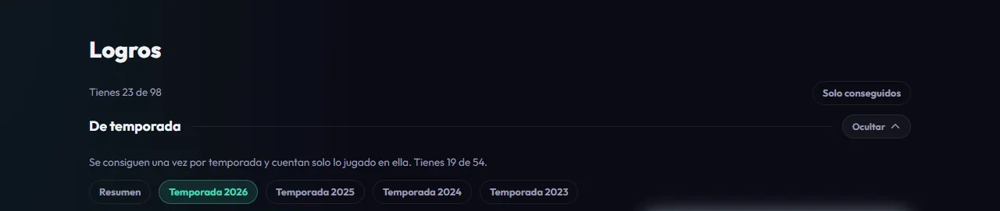

# Logros

Los logros se desbloquean **solos** al jugar (nunca los pides tú) y se anuncian al grupo. Averiguar de qué van y cómo se consiguen es parte del juego.

{ .screenshot }

## La página de logros

**Menú → Logros** tiene dos bloques, cada uno con su «Tienes X de Y»:

- **De temporada**: se consiguen una vez al año y cuentan solo lo jugado en esa temporada. Hay una pastilla **Resumen**, que junta todas las temporadas (con las temporadas en que conseguiste cada logro), y una pastilla por temporada (la en curso por defecto); cada una muestra quién del grupo lo consiguió *en ese año* y, en la temporada actual, cuánto te falta.
- **Lifetime** («de por vida»): cuentan todo tu historial y se consiguen **una sola vez**.

El botón **Solo conseguidos** deja solo los que ya has desbloqueado (el «Tienes X de Y» sigue contando todos). Cada tarjeta muestra el logro, su descripción y quién lo tiene. Los que aún no tienes aparecen **atenuados y solo con el nombre**, y algunos no enseñan nada hasta que los consigues. Algunos logros brillan con un **aura de color**.

Los logros que se acumulan muestran una **barra de progreso** («35 / 100»); los que dependen de otra cosa no tienen barra.

## Para descubrir

Hay logros de todo tipo, y también unos cuantos **«del mundo exterior»**: no dependen solo de cuánto juegas, sino de cuándo y a qué. Descubre cuáles.

Se van **añadiendo logros nuevos** con el tiempo; no son retroactivos.

## Cuando algo no cuadra

Los logros se reevalúan cada vez que paras un timer o cambias sesiones o biblioteca. Si corriges una sesión que te dio un logro por error, el logro se retira (sin avisar) si ya no cumples la condición. Si crees que falta alguno, pídele a un administrador que **recalcule los logros**.
