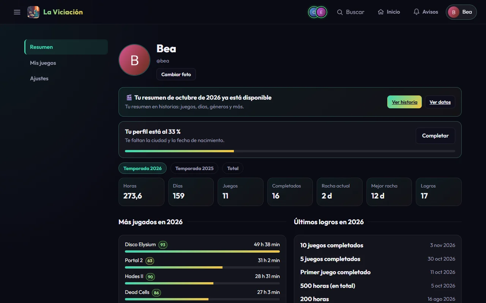
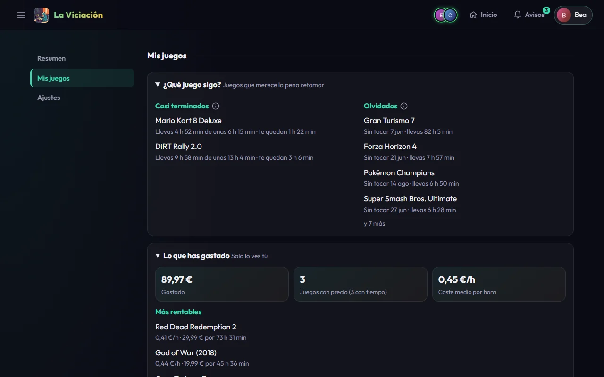
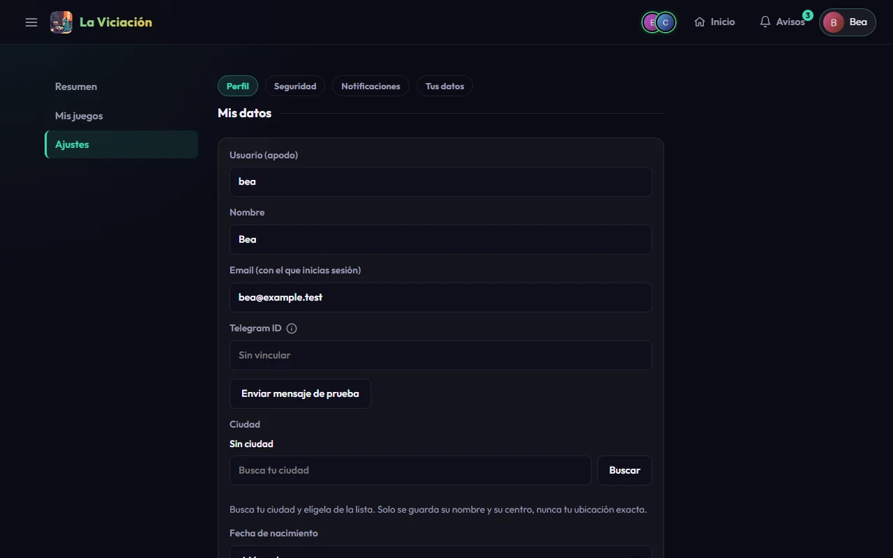

# Tu perfil

Desde el menú, **Mi perfil** (o tu nombre en la barra superior) abre tus cifras. A la izquierda tienes tres secciones: **Resumen**, **Mis juegos** y **Ajustes**.

## Resumen

{ .screenshot }

Arriba, con una pastilla por **temporada** (y **Total** para todo el historial), ves tus cifras:

| Cifra | Qué es |
|---|---|
| **Horas** | Tiempo jugado en la temporada. |
| **Días** | Días en que has jugado (una sesión de 10 min o más). |
| **Juegos** | Juegos distintos que has jugado. |
| **Completados** | Juegos que has terminado. |
| **Racha actual / Mejor racha** | Días seguidos jugando. La racha actual solo aparece en la temporada en curso y en el total. |
| **Logros** | Logros que has conseguido. |

Debajo, tus **más jugados**, tus **últimos logros** de la temporada (los cinco más recientes), tus **retos** y la lista de **juegos**, que se puede plegar (el navegador recuerda si la dejaste plegada). Cada juego tiene sus botones: *Sesiones* (despliega y deja editar las de esta temporada), *Puntuar* o *Cambiar nota* (con *Quitar nota* si ya tiene), *Marcar completado* (o, si ya lo está, *Cambiar fecha* y *Desmarcar*), *Abandonar* (o *Retomar*) y *Precio*. El nombre del juego lleva a su página.

Mientras te falte la foto, la ciudad o la fecha de nacimiento, arriba sale una tarjeta con el porcentaje del perfil completado y un botón **Completar**. Al abrir la app también puede salir un aviso en la parte baja: con **Ahora no** vuelve a la semana, y deja de salir un mes después de la primera vez o en cuanto el perfil esté completo.

Para cambiar tu foto, pulsa **Cambiar foto** (PNG o JPG).

## Mis juegos

Toda tu biblioteca, de todas las temporadas, con filtros por nombre (**Buscar juego**), temporada, estado, nota y plataforma. Encima de la lista te dice cuántos juegos hay («12 de 80 juegos») y, si son muchos, **Mostrar más** carga el resto.

{ .screenshot }

**Precio y coste por hora.** Cada juego tiene un botón **Precio**: apunta lo que pagaste por él, una casilla por cada plataforma en la que lo tienes (si lo compraste en PC y en Switch son dos precios; una casilla vacía quita el precio). El juego pasa a decir «Pagado: 24,99 €» y encima de la lista aparece **Lo que has gastado**: cuánto llevas gastado, el coste medio por hora y tus juegos más y menos rentables (los que han costado menos y más por hora jugada; solo cuentan los que has jugado al menos media hora). **Los precios son solo tuyos**: nadie del grupo los ve. Del grupo solo se enseña el coste medio por hora de un juego cuando al menos 3 jugadores han apuntado su precio (ver [Grupo](grupo.md)), y nunca el de nadie en concreto.

Si has jugado un mismo juego en varias plataformas dentro de una temporada, sale **en una sola fila** con todas sus plataformas, no una por plataforma; las horas son las del juego entero y el filtro de plataforma encuentra la fila con cualquiera de ellas.

Cada juego sin terminar tiene un **estado**: *En curso*, *Pausado* (llevas más de 30 días sin jugarlo), *Pendiente* (lo tienes pero nunca lo has jugado), *Completado*, *Abandonado* o *Sin completar* (se quedó a medias en una temporada ya cerrada). Se puede filtrar por cualquiera.

Encima de la lista, **¿Qué juego sigo?** propone a qué volver (el icono **i** de cada lista explica cómo se elige): los **casi terminados** (llevas al menos el 70 % de lo que suele durar), los **olvidados** (más de 60 días sin tocarlos) y los **cortos** (duran menos de 5 horas según HowLongToBeat, los hayas empezado o no). Usa el tiempo medio de HowLongToBeat, así que un juego sin tiempo medio solo puede salir como olvidado.

**Puntuar al azar** (el botón solo sale si te quedan juegos sin nota) abre un juego de los que todavía no has puntuado: pones la nota, y con cada una te sale el siguiente hasta que no queden. **Omitir, ver otro** pasa al siguiente y **Dejar de puntuar** cierra la ventana.

## Ajustes

{ .screenshot }

Los ajustes están en cuatro grupos, que eliges con los botones de arriba: **Perfil**, **Seguridad**, **Notificaciones** y **Tus datos**.

- **Perfil** (Mis datos): tu nombre y tu email (con el que inicias sesión) se pueden cambiar con **Guardar datos**; tu usuario (apodo) no. Además verás tu **Telegram ID** (solo se ve: se vincula con `/activate` en el grupo y solo un administrador puede cambiarlo o quitarlo; hay un botón para enviarte un mensaje de prueba), tu **ciudad** y tu **fecha de nacimiento**. Para poner la ciudad, escribe su nombre (al menos dos letras), pulsa **Buscar**, elige una de las que salen y guarda; **Quitar** la borra. Nada se guarda hasta que pulsas **Guardar datos**. La ciudad y la fecha son datos opcionales que puedes rellenar para que la app haga cosas chulas con ellos; nadie más los ve. Debajo están tus IDs de **Nintendo** (código de amigo), **Xbox** (gamertag), **PlayStation** (ID de PSN), **Steam** y **Discord**: son opcionales, se escriben tal cual (hasta 64 caracteres; vacío lo borra) y, al contrario que lo anterior, los ven todos los jugadores en tu página, para que puedan añadirte.
- **Seguridad**: cambia tu contraseña cuando quieras (la actual y la nueva dos veces; la nueva debe tener de 12 a 24 caracteres, con mayúscula, minúscula, número y un carácter especial) y cierra la sesión en ese dispositivo.
- **Notificaciones**: qué avisos privados quieres recibir y por qué canal (Telegram y/o móvil), y los dispositivos en los que tienes las notificaciones activadas (con **Activar avisos en este dispositivo**, una casilla **Avisos del grupo** por dispositivo y **Quitar**). Más en [Notificaciones y Telegram](notificaciones.md).
- **Tus datos**: **Descargar mis datos** te da un archivo `.json` con tus sesiones, tu biblioteca, tus notas, los precios que has apuntado, tu lista de deseados y tus logros.
