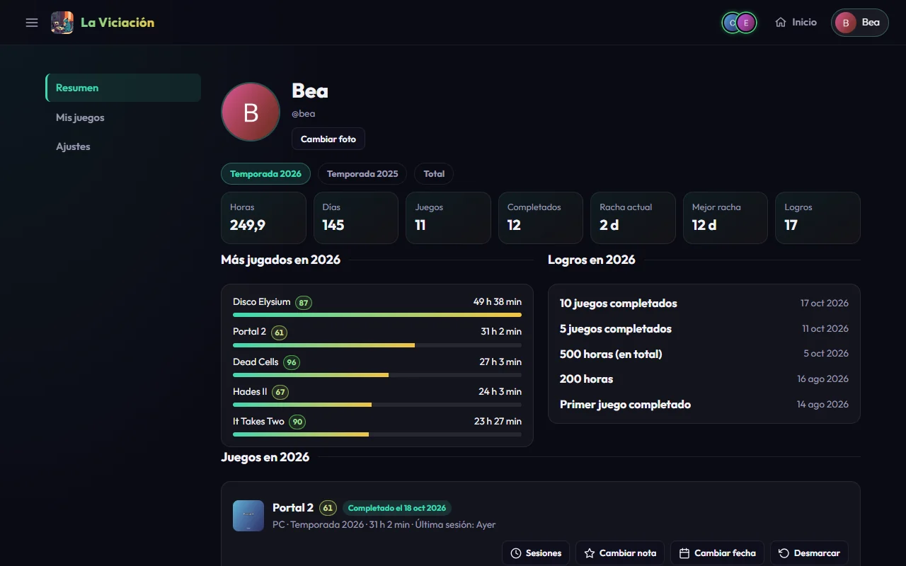
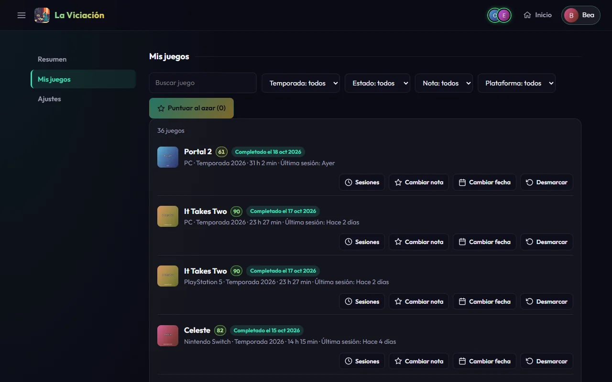
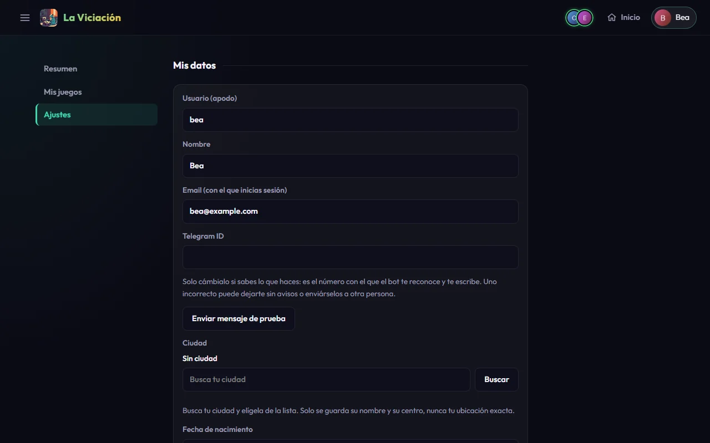

# Tu perfil

Desde el menú, **Mi perfil** (o tu nombre en la barra superior) abre tus cifras. A la izquierda tienes tres secciones: **Resumen**, **Mis juegos** y **Ajustes**.

## Resumen

{ .screenshot }

Arriba, con una pastilla por **temporada** (y **Total** para todo el historial), ves tus cifras:

| Cifra | Qué es |
|---|---|
| **Horas** | Tiempo jugado en la temporada. |
| **Días** | Días en que has jugado (una sesión de 10 min o más). |
| **Juegos** | Juegos distintos que has jugado. |
| **Completados** | Juegos que has terminado. |
| **Racha actual / Mejor racha** | Días seguidos jugando. La racha actual solo aparece en la temporada en curso y en el total. |
| **Logros** | Logros que has conseguido. |

Debajo, tus **más jugados**, tus **logros** de la temporada, tus **retos** y la lista completa de **juegos** con sus botones: *Sesiones*, *Cambiar nota*, *Marcar completado* y *Abandonar*.

Para cambiar tu foto, pulsa **Cambiar foto** (PNG o JPG).

## Mis juegos

Toda tu biblioteca, de todas las temporadas, con filtros por nombre, temporada, estado, nota y plataforma.

{ .screenshot }

**Precio y coste por hora.** Cada juego tiene un botón **Precio**: apunta lo que pagaste por él, una casilla por cada plataforma en la que lo tienes (si lo compraste en PC y en Switch son dos precios; una casilla vacía quita el precio). El juego pasa a decir «Pagado: 24,99 €» y encima de la lista aparece **Lo que has gastado**: cuánto llevas gastado, el coste medio por hora y tus juegos más y menos rentables (los que han costado menos y más por hora jugada; solo cuentan los que has jugado al menos media hora). **Los precios son solo tuyos**: nadie del grupo los ve. Del grupo solo se enseña el coste medio por hora de un juego cuando al menos 3 jugadores han apuntado su precio (ver [Grupo](grupo.md)), y nunca el de nadie en concreto.

Cada juego sin terminar tiene un **estado**: *En curso*, *Pausado* (llevas más de 30 días sin jugarlo), *Pendiente* (lo tienes pero nunca lo has jugado), *Completado*, *Abandonado* o *Sin completar* (se quedó a medias en una temporada ya cerrada). Se puede filtrar por cualquiera.

Encima de la lista, **¿Qué juego sigo?** propone a qué volver: los **casi terminados** (llevas al menos el 70 % de lo que suele durar), los **olvidados** (más de 60 días sin tocarlos) y los **cortos** (te quedan 4 horas o menos, o duran eso y aún no los has jugado). Usa el tiempo medio de HowLongToBeat, así que un juego sin tiempo medio solo puede salir como olvidado.

**Puntuar al azar** abre un juego de los que todavía no has puntuado: pones la nota, y con cada una te sale el siguiente hasta que no queden. **Omitir, ver otro** pasa al siguiente y **Dejar de puntuar** cierra la ventana.

## Ajustes

{ .screenshot }

Los ajustes están en cuatro grupos, que eliges con los botones de arriba: **Perfil**, **Seguridad**, **Notificaciones** y **Tus datos**.

- **Perfil** (Mis datos): tu nombre, tu usuario, tu email, tu **Telegram ID** (con un botón para enviarte un mensaje de prueba), tu **ciudad** y tu **fecha de nacimiento**. La ciudad y la fecha de nacimiento solo sirven para algunos [logros secretos](logros.md) (el tiempo, los eclipses, tu cumpleaños…); nadie más las ve.
- **Seguridad**: cambia tu contraseña cuando quieras y cierra la sesión en ese dispositivo.
- **Notificaciones**: qué avisos privados quieres recibir y por qué canal (Telegram y/o móvil), y los dispositivos en los que tienes las notificaciones activadas. Más en [Notificaciones y Telegram](notificaciones.md).
- **Tus datos**: **Descargar mis datos** te da un archivo `.json` con tus sesiones, tu biblioteca, tus notas, los precios que has apuntado, tu lista de deseados y tus logros.
