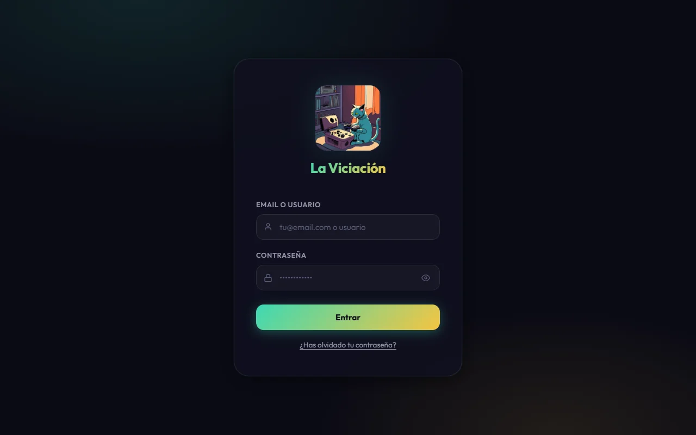
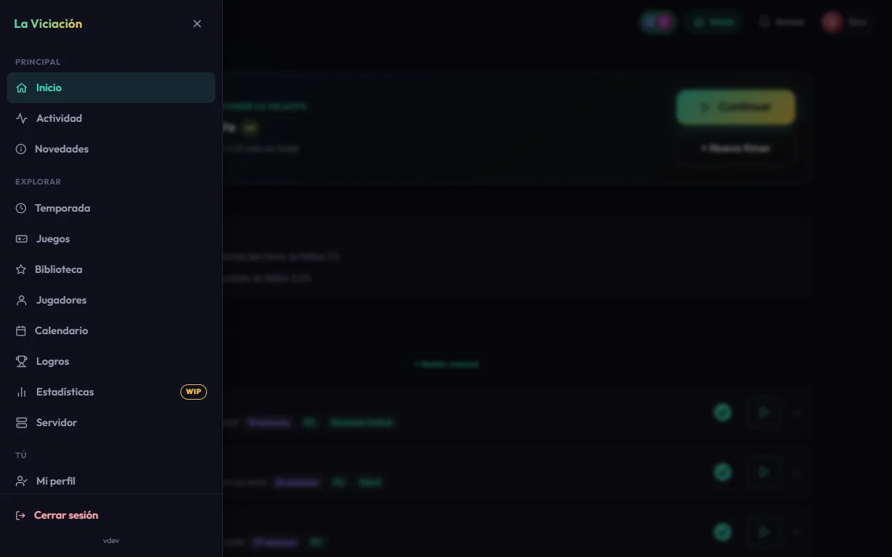
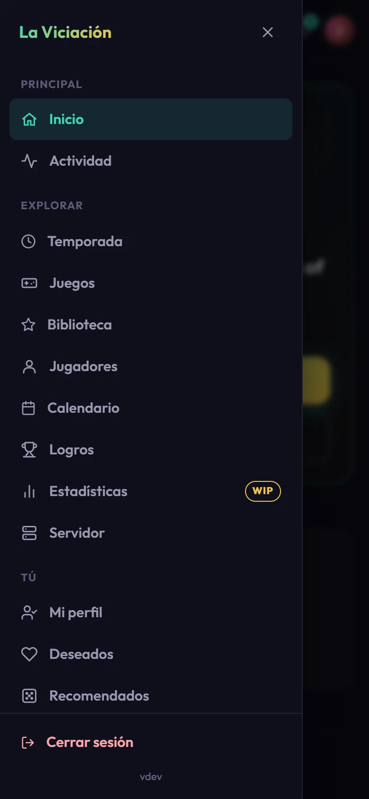
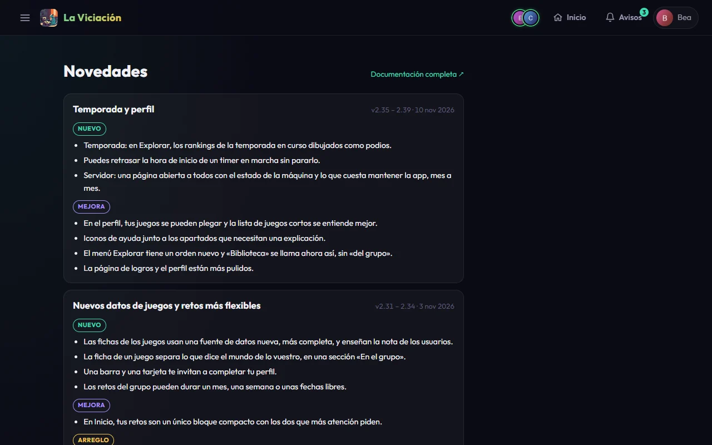

# Primeros pasos

## Entrar

Abre la dirección de la app que te haya dado tu administrador e introduce tu **email o usuario** y tu **contraseña**.

{ .screenshot }

!!! tip "¿Has olvidado la contraseña?"
    Pulsa **¿Has olvidado tu contraseña?**, escribe tu email o tu usuario y recibirás un correo con un enlace (válido durante 1 hora) para elegir una nueva. Si tu grupo no tiene el correo configurado, pídele a un administrador que te ponga una desde el panel.

Si cambias o restableces tu contraseña, la sesión se cierra en todos tus dispositivos.

## Moverte por la app

El botón de la esquina superior izquierda abre el **menú lateral**, con todas las páginas agrupadas:

{ .screenshot }

- **Principal**: [Inicio](sesiones.md) y [Actividad](grupo.md#actividad).
- **Grupo** (lo que va de las personas): [Temporada](grupo.md#temporada) (los rankings de la temporada en curso), [Jugadores](grupo.md#jugadores), [Retos](retos.md) y [Logros](logros.md).
- **Juegos**: [Juegos](juegos.md#juegos), [Biblioteca](juegos.md#biblioteca-del-grupo) y [Calendario](juegos.md#calendario).
- **Tú** (lo que es tuyo): [Mi perfil](perfil.md), [Deseados](descubrir.md#deseados) y [Recomendados](descubrir.md#recomendados).
- **Más**: [Ajustes](perfil.md#ajustes), [Servidor](grupo.md#servidor) y, solo si eres administrador, el panel de **Administración**.
- **Cerrar sesión**, al final. Bajo ese botón sale la **versión** de la app (por ejemplo «v2.39.0»); al pulsarla se abre la página de Novedades.

En la barra superior tienes siempre el acceso a la **búsqueda** (la lupa; también con la tecla **/** o **Ctrl+K**: encuentra páginas, jugadores y juegos), a **Inicio**, a tu **perfil** y a la campana de **[Avisos](notificaciones.md#avisos-dentro-de-la-app)** (con un número cuando tienes alguno sin leer), y a la derecha de la marca, el aviso de [quién está jugando ahora](grupo.md).

En el móvil, abajo hay además una **barra de pestañas** con **Inicio**, **Grupo**, **Buscar**, **Juegos** y **Tú**: cada una te lleva a la página principal de su sección, y el resto de páginas están en el menú.

En el móvil el menú ocupa toda la pantalla:

{ .screenshot width="260" }

## Novedades

**Pulsar la versión al pie del menú** cuenta lo que ha ido cambiando en la app, de lo más reciente a lo más antiguo: lo nuevo, las mejoras y los arreglos que se notan al usarla. Las versiones pequeñas se juntan en una sola entrada, para no saturar.

{ .screenshot }

## El asistente

En todas las pantallas hay un botón redondo, abajo a la derecha, que abre un chat donde preguntar sobre videojuegos, los datos del grupo y cómo funciona la app (si el administrador tiene la IA activada). Más en [Asistente](asistente.md).

## El resumen

A principios de cada mes la app te ofrece el [Resumen](resumen.md) del mes anterior, y a final de año el de la temporada.

## Instalarla como app

La Viciación es una **PWA**: puedes instalarla en el móvil o en el ordenador y se abre como una app más, sin barra del navegador.

=== "Android (Chrome)"

    Menú ⋮ → **Instalar aplicación** (o **Añadir a la pantalla de inicio**).

=== "iPhone / iPad (Safari)"

    Botón de compartir → **Añadir a pantalla de inicio**. Es imprescindible para recibir [notificaciones](notificaciones.md) (iOS 16.4 o superior).

=== "Ordenador (Chrome / Edge)"

    Icono de instalar en la barra de direcciones, o menú → **Instalar La Viciación**.

Una vez instalada, al mantener pulsado su icono tienes atajos a **Nuevo timer**, **Jugando ahora** y **Mi perfil**.

## Avisos en tu dispositivo

La primera vez que entras, la app te ofrece activar las notificaciones en ese dispositivo. Puedes decir **Ahora no** y cambiarlo cuando quieras desde [tu perfil](perfil.md#ajustes).
