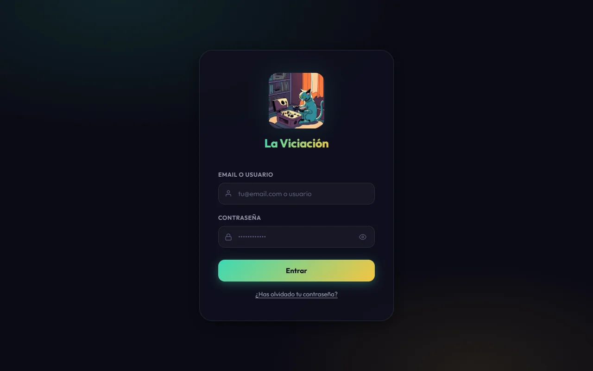
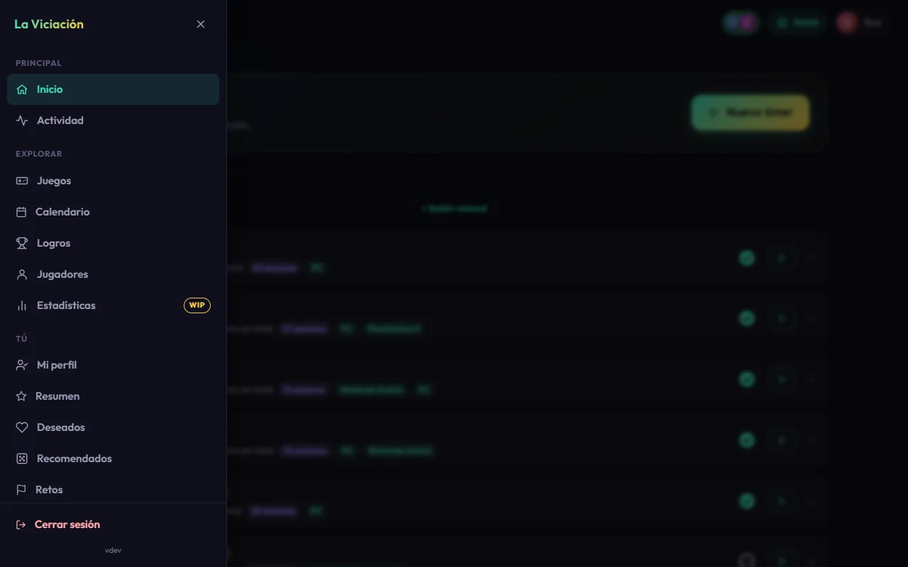
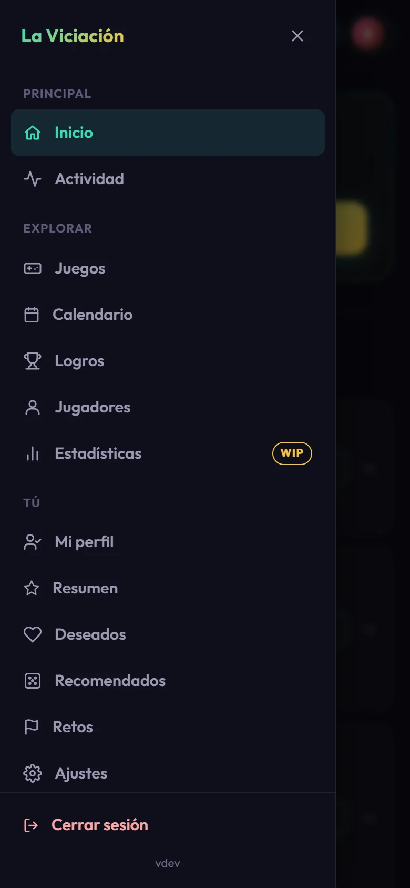

# Primeros pasos

## Entrar

Abre la dirección de la app que te haya dado tu administrador e introduce tu **email o usuario** y tu **contraseña**.

{ .screenshot }

!!! tip "¿Has olvidado la contraseña?"
    Pulsa **¿Has olvidado tu contraseña?**, escribe tu email o tu usuario y recibirás un correo con un enlace (válido durante 1 hora) para elegir una nueva. Si tu grupo no tiene el correo configurado, pídele a un administrador que te ponga una desde el panel.

Por seguridad, tras **5 intentos fallidos** seguidos la cuenta se bloquea un rato. Si cambias o restableces tu contraseña, la sesión se cierra en todos tus dispositivos. Tu sesión dura unos 7 días mientras no dejes de usar la app.

## Moverte por la app

El botón de la esquina superior izquierda abre el **menú lateral**, con todas las páginas agrupadas:

{ .screenshot }

- **Principal**: Inicio y Actividad.
- **Explorar** (lo que es de todo el grupo): Juegos, Biblioteca del grupo, Calendario, Logros, Jugadores y Estadísticas (todavía en construcción).
- **Tú** (lo que es tuyo): Mi perfil, Resumen, Deseados, Recomendados, Retos y Ajustes.
- **Administración**: solo si eres administrador.
- **Cerrar sesión**, al final.

En la barra superior tienes siempre el acceso a **Inicio** y a tu **perfil**, y a la derecha de la marca, el aviso de [quién está jugando ahora](grupo.md).

En el móvil el menú ocupa toda la pantalla:

{ .screenshot width="260" }

## Instalarla como app

La Viciación es una **PWA**: puedes instalarla en el móvil o en el ordenador y se abre como una app más, sin barra del navegador.

=== "Android (Chrome)"

    Menú ⋮ → **Instalar aplicación** (o **Añadir a la pantalla de inicio**).

=== "iPhone / iPad (Safari)"

    Botón de compartir → **Añadir a pantalla de inicio**. Es imprescindible para recibir [notificaciones](notificaciones.md) (iOS 16.4 o superior).

=== "Ordenador (Chrome / Edge)"

    Icono de instalar en la barra de direcciones, o menú → **Instalar La Viciación**.

Una vez instalada, al mantener pulsado su icono tienes atajos a **Nuevo timer**, **Jugando ahora** y **Mi perfil**.

## Avisos en tu dispositivo

La primera vez que entras, la app te ofrece activar las notificaciones en ese dispositivo. Puedes decir **Ahora no** y cambiarlo cuando quieras desde [tu perfil](perfil.md#ajustes).
