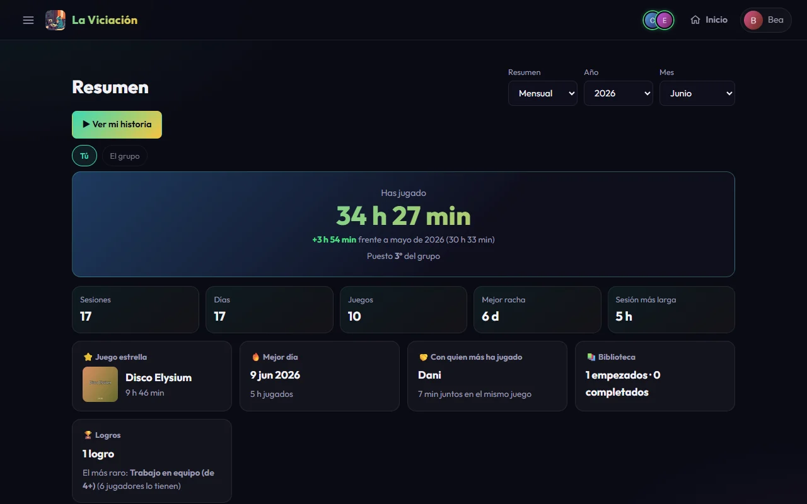
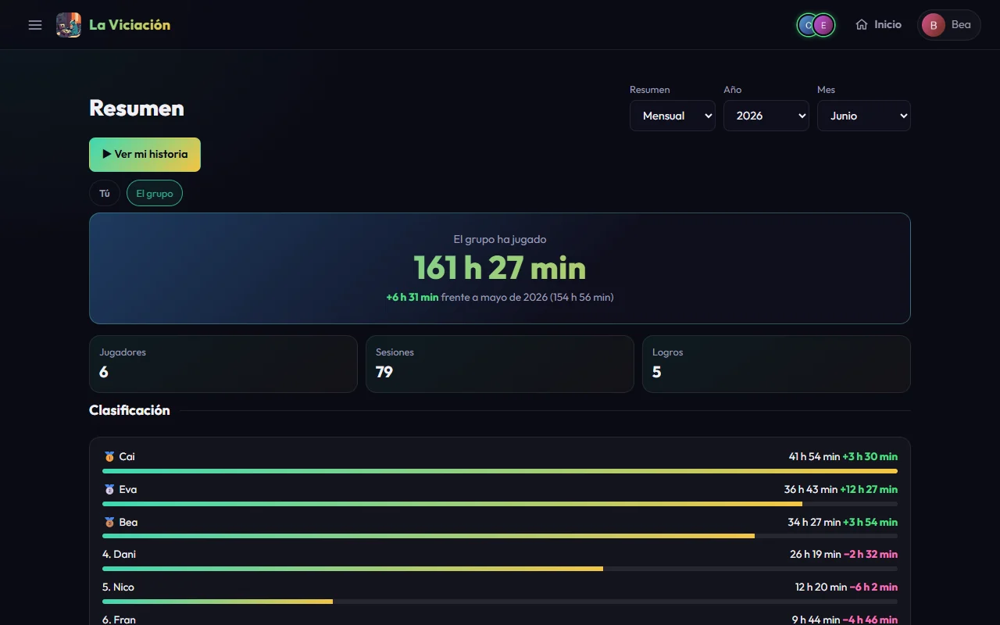
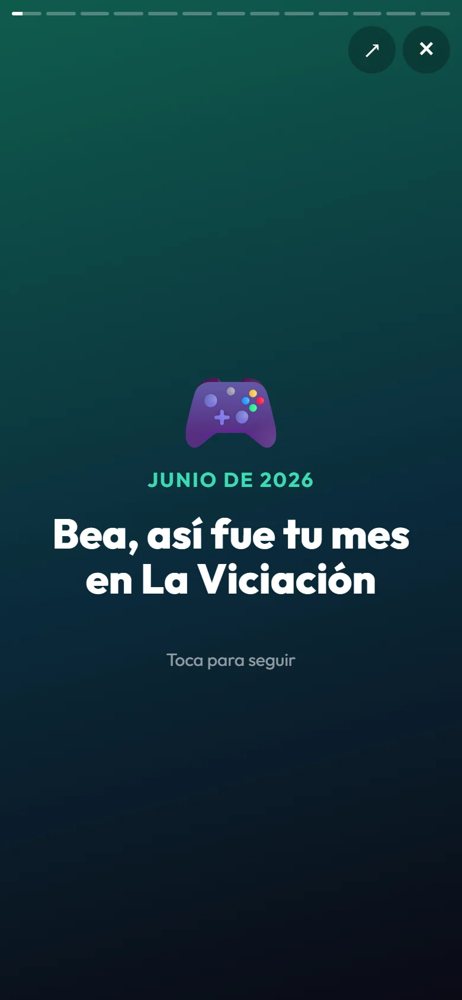
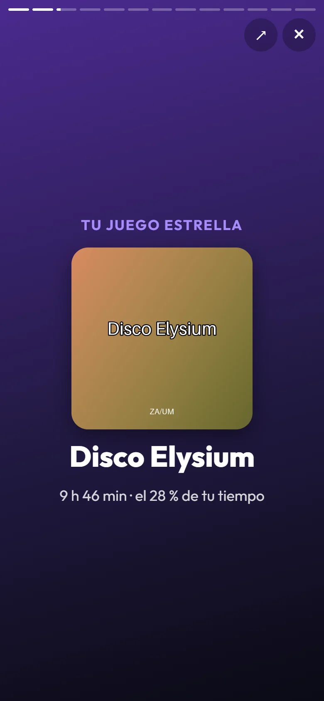
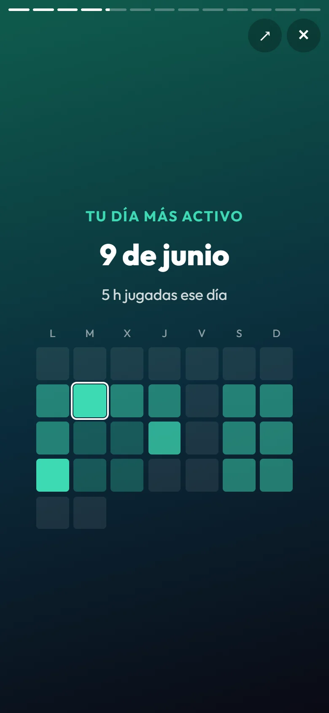

# Resumen e historia

El **Resumen** es el «Wrapped» de La Viciación: cómo fue un mes o una temporada, para ti y para el grupo. Solo está disponible durante unos días: en la tarjeta de tu **perfil**, en la barra de aviso o desde el enlace del anuncio (no hay entrada en el menú).

{ .screenshot }

## Qué incluye

- **Tu resumen** (pestaña **Tú**): las horas jugadas frente al periodo anterior, tu puesto en el grupo, sesiones, días y juegos, tu mejor racha y tu sesión más larga, tu **juego estrella**, tu **mejor día**, con quién has jugado más al mismo juego, lo que has empezado y completado y tu logro más raro.
- **El grupo** (pestaña **El grupo**): las horas totales, la clasificación con la variación de cada jugador, los juegos más jugados, el día más movido y los logros conseguidos.

{ .screenshot }

Si un administrador ha habilitado los resúmenes de forma permanente, arriba a la derecha eliges el periodo (si no, solo ves el que toca): **Mensual** o **Anual**, el año (desde 2023) y, en mensual, el mes. Solo se pueden elegir meses y temporadas **ya terminados**. La temporada en curso permanece bloqueada hasta que un administrador la desbloquea (o hasta que se anuncia, en diciembre o enero), para que nadie vea cómo cambia día a día antes de tiempo.

## La historia

**Ver mi historia** convierte el resumen en una secuencia de pantallas, como el resumen del año de una app de música: tus horas, tu juego estrella y tu top 5 con portadas, tu mejor día (con la cuadrícula del mes), tu día de la semana favorito, en qué momento del día juegas, tus géneros, tu racha, tu compañero habitual, tus logros y el podio del grupo. Las pantallas sin datos se omiten.

{ .screenshot width="240" }

{ .screenshot width="240" }

{ .screenshot width="240" }

- **Avanzar**: toca el lado derecho (o `→` o espacio). **Retroceder**: el izquierdo (o `←`). Mantén pulsado para pausar, desliza para moverte, `Esc` o ✕ para salir. En una pantalla ancha se muestra como una tarjeta vertical.
- **Compartir**: cada pantalla se puede guardar como imagen vertical (1080×1920) desde el botón de compartir de la esquina: abre el menú de compartir del móvil o descarga el PNG en el ordenador.

## Los avisos

El resumen de un mes (o de una temporada) **solo se puede abrir los primeros días después de que termine** (del 1 al 5 del mes siguiente; en enero, también el de la temporada). Pasado ese plazo ya no se puede ver, ni con un enlace antiguo, salvo que un administrador lo habilite.

Los primeros días de cada mes (del 1 al 5), si el aviso del resumen está activado, la app te ofrece el resumen del mes que acaba de terminar con una barra en la parte superior y una tarjeta en tu perfil, por si no tienes las notificaciones. En enero se ofrecen dos periodos: la temporada que terminó y diciembre. Si el grupo lo tiene activado, el resumen también se anuncia por Telegram y por notificación, con un enlace directo a la historia.
