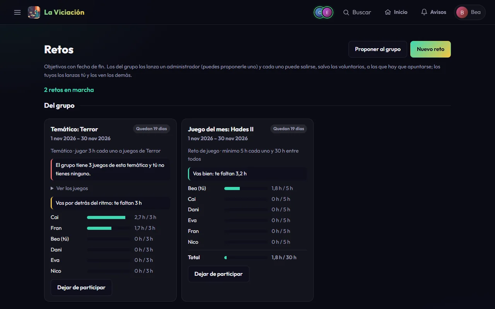

# Retos

**Menú → Retos** reúne objetivos con fecha de inicio y de fin, a diferencia de los logros. Hay dos tipos:

{ .screenshot }

**Del grupo** (los lanza un administrador):

- **Reto de juego** (el *juego del mes* cuando dura un mes): un juego, un mes, una semana o unas fechas, unas horas mínimas por jugador y un total entre todos. Ves una barra por jugador (verde al llegar a su mínimo) y otra para el grupo.
- **Temático**: una temática (un género, una ambientación o un tema: Terror, Metroidvania, Medieval…), un mes y lo que tiene que hacer cada jugador: jugar un número de horas o completar al menos un juego. Cuenta cualquier juego de esa temática. En la tarjeta del reto ves cuántos juegos de esa temática tiene el grupo y cuántos tienes tú (en rojo si no tienes ninguno, para que decidas si compras alguno, te sales o no te apuntas), y **Ver los juegos** los lista con quién los tiene.

- **Horas entre todos**: un mes y un total de horas que tiene que sumar el grupo entero, de cualquier juego. No hay mínimo por jugador: cada uno ve cuánto ha aportado, y cumple su parte si el grupo llega al total y él ha jugado algo.

La página reúne los retos en bloques: **Del grupo**, **Tuyos**, **Duelos** (los tuyos) y **De otros jugadores** (los personales y duelos que han lanzado los demás, que puedes mirar). En cada bloque van primero los que están en marcha y luego los terminados, pero solo se enseñan los **5 últimos terminados**: **Ver todos los terminados** carga el resto. Arriba, una línea resume tus retos («3 retos en marcha · 1 cumplido · 1 con poco tiempo»). En cada tarjeta ves cuánto tiempo queda y el progreso de cada jugador.

Puedes **dejar de participar** y volver mientras el reto no haya terminado. Cuando el grupo alcanza el total, se avisa una vez. Un administrador puede lanzar un reto del grupo como **voluntario**: no cuenta nadie hasta que se **apunta** (botón *Apuntarme*), y solo cuentan los que se apuntan.

**Proponer un reto al grupo.** Con **Proponer al grupo** sugieres un reto de juego o un reto temático (el juego o la temática, el periodo —un mes, una semana o unas fechas— y las horas). Un administrador lo aprueba, y entonces se lanza como un reto del grupo, o lo rechaza con una nota. En **Tus propuestas** ves en qué estado está cada una y puedes **retirar** las que aún esperan respuesta. Puedes tener hasta 3 esperando a la vez.

**Personales** (los lanzas tú con **Nuevo reto**; los demás los ven, pero nadie recibe aviso):

- **Probar un género**: elige un género de la base de datos y juega unas horas (2 por defecto) o completa uno de esos juegos, en una semana, un mes o tres meses. Solo cuentan juegos de ese género que no tuvieras ya en tu biblioteca.
- **Bajar la deuda**: un objetivo sobre tu **deuda** (lo que te falta para terminar los juegos que has empezado), en porcentaje o en número de juegos. La app te dice, antes de lanzarlo, lo que significa («El 25 % de tu deuda son unas 10 h»).
- **Racha**: juega varios días seguidos (o varios días distintos) dentro del plazo. Un día cuenta cuando juegas al menos 10 minutos, igual que en las rachas y los logros.
- **Sesiones largas**: haz un número de sesiones de al menos los minutos que elijas, de cualquier juego.
- **Variar de género**: juega a varios géneros distintos, dedicando a cada uno las horas que pidas. El tiempo de un juego cuenta en cada uno de sus géneros.
- **Cumplir deseados**: empieza o completa juegos de tu lista de deseados. Solo cuentan los que ya estaban en ella el día que lanzas el reto; si quitas uno de la lista, deja de contar.
- **Terminar lo empezado**: completa un número de los juegos que ya tenías empezados (con una sesión de 10 minutos o más, sin completar ni abandonar) cuando lanzas el reto. Los juegos que empieces después no cuentan.
- **Terminar antes de empezar**: no puedes empezar ningún juego nuevo sin haber terminado antes uno de los que ya tenías empezados. **Ganas** al completar uno de ellos y **pierdes** en el momento en que empiezas un juego nuevo sin haber completado antes ninguno. Si lo haces el mismo día, cuenta primero el que completaste. Para lanzarlo necesitas tener al menos un juego empezado y sin terminar.

**Cómo vas.** Cada reto en el que participas te dice, dentro de la propia app, cómo estás: *Ya has cumplido tu parte*, *Vas bien*, *Vas por detrás del ritmo* (llevas menos de lo que toca por el tiempo que ha pasado), o, en los últimos días, *Quedan 2 días: te faltan 1,5 h*. Arriba de la página se cuenta cuántos tienes en marcha, cuántos cumplidos y cuántos con poco tiempo, y en el **Inicio** aparece una tarjeta **Mis retos** con los que están en marcha, los más urgentes primero. Es solo para ti: no se avisa a nadie.

- **Duelo de horas**, **Duelo en un juego** y **Duelo de completados**: retas a otro jugador a ver quién juega más (en total o a un juego concreto) o quién completa más juegos, durante una semana, un mes o tres meses. **Empieza al lanzarlo**; el retado puede **rechazarlo durante las primeras 48 horas** (el rechazo no se puede deshacer). Pasado ese plazo, el duelo sigue adelante. Gana quien más horas (o más juegos completados) sume y, si empatan, ganan los dos. Un duelo rechazado no cuenta para nadie. Los demás lo ven, pero nadie recibe aviso. El retado lo rechaza con **Rechazar duelo**, que desaparece pasadas las 48 horas.

Un reto personal o un duelo que lanzaste lo puedes quitar con **Borrar** (pide una segunda pulsación).

El administrador puede lanzar un reto del grupo (de juego o temático) **como competición**: además de cumplir el objetivo, se ve quién va primero, con medallas, y el puesto aparece en tu línea.

Tus retos terminados, con cómo te fue, quedan en **Perfil → Resumen → Retos**.
