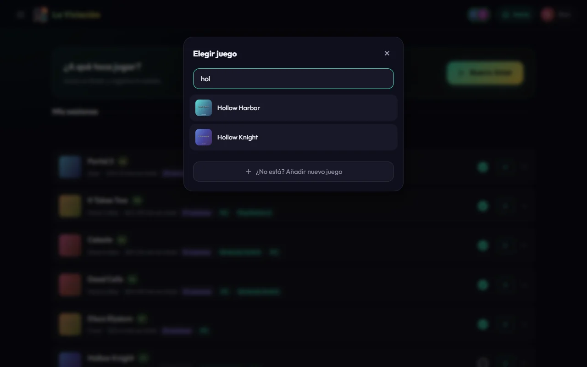
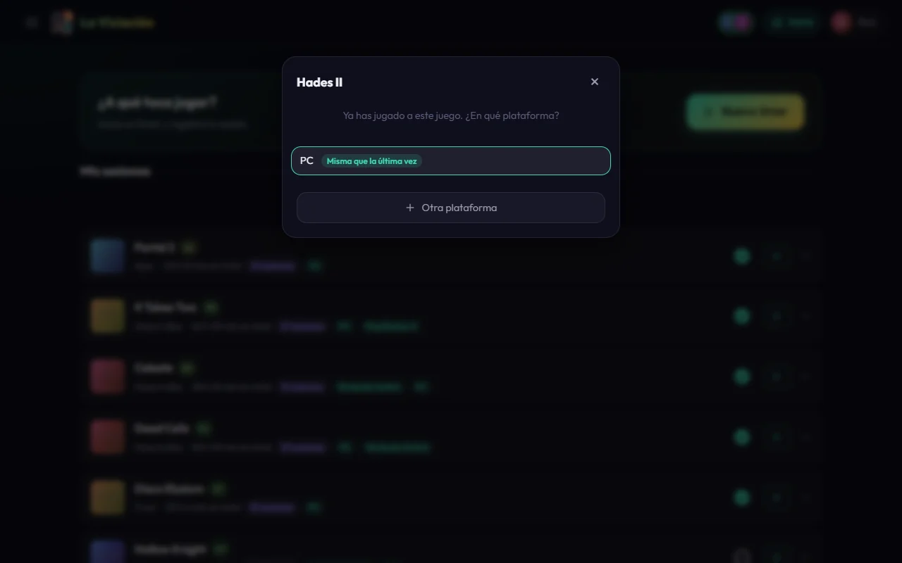
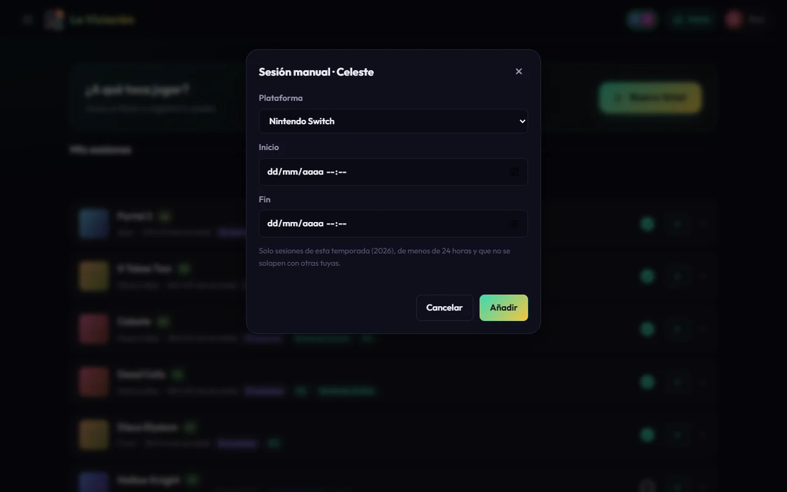
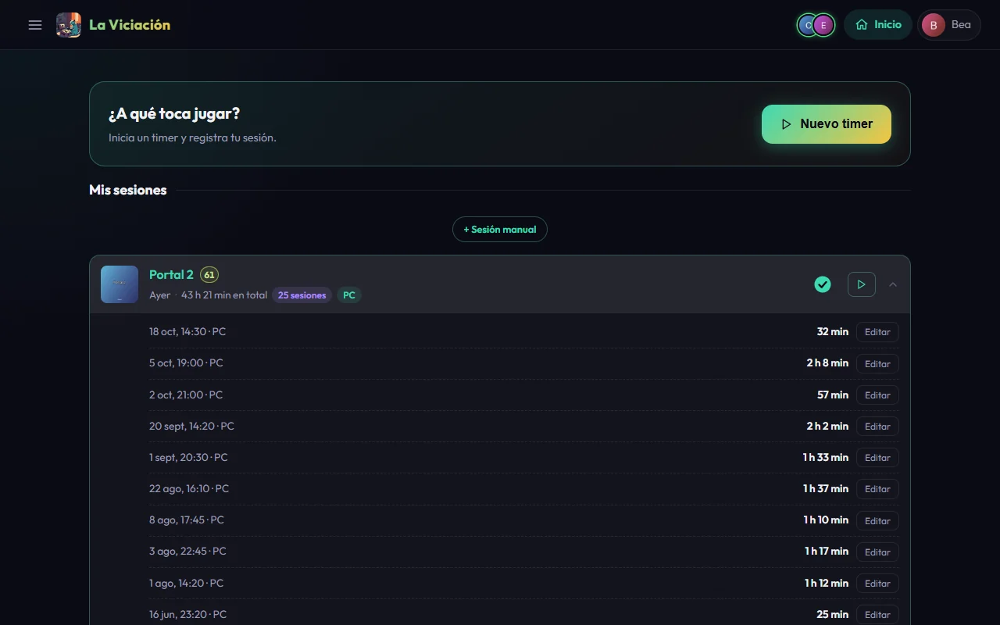
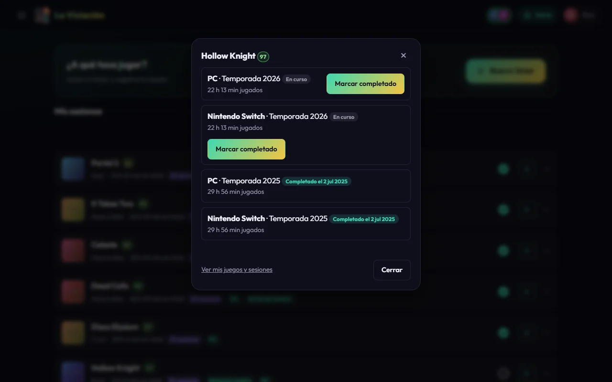

# Timers y sesiones

Una **sesión** es un rato jugando a un juego en una plataforma. Es lo único que registras tú: todo lo demás (horas, rankings, rachas, logros…) se calcula a partir de ellas.

## Con un timer

Es la forma habitual: pulsas al empezar y paras al terminar.

1. En **Inicio**, pulsa **Nuevo timer**.
2. Busca el juego en el catálogo del grupo y elígelo.
3. Elige la **plataforma**. Si ya lo habías jugado, la que usaste la última vez aparece la primera.
4. El timer empieza a correr. Cuando termines, pulsa **Detener**; si te has equivocado y no quieres que cuente, **Cancelar**.

{ .screenshot }

{ .screenshot }

{ .screenshot }

Mientras tu timer corre, el resto del grupo te ve como «jugando ahora» (puedes ver [quién juega](grupo.md) en la barra superior). Si tienes las [notificaciones](notificaciones.md) activadas, en tus dispositivos aparece una notificación fija con el juego y la hora de inicio; al tocarla se abre la app para que pares el timer.

!!! note "Si te olvidas de pararlo"
    Pasadas 4 horas (por defecto), la app te recuerda una sola vez que tienes un timer abierto. Puedes desactivar el aviso o cambiar las horas en **Perfil → Ajustes → Notificaciones**. Un timer olvidado se puede cerrar a mano editando su hora de fin, o pidiéndole a un administrador que lo haga.

### ¿No encuentras el juego?

Cualquiera puede añadir juegos al catálogo compartido. En el buscador pulsa **¿No está? Añadir nuevo juego**: se busca en RAWG, y si el juego no aparece ahí, **¿No aparece? Crearlo a mano** crea uno solo con el nombre (la fecha, el desarrollador y la portada se pueden completar después desde el panel de administración).

## A mano, después de jugar

Si no has usado el timer, pulsa **+ Sesión manual** en Inicio, elige el juego y rellena la plataforma y las horas de **inicio** y **fin**. Antes de guardar, la app te dice cuánto tiempo vas a añadir («Vas a añadir 1 h 30 min a …») y te pide confirmar.

{ .screenshot }

Las sesiones manuales tienen unas reglas, para que los datos sean fiables:

- El fin tiene que ser **posterior al inicio** y **no estar en el futuro**.
- Dura **como máximo 24 horas**.
- Solo de la **temporada en curso**: las temporadas cerradas quedan congeladas.
- **No puede solaparse** con otra sesión tuya.
- No se puede añadir mientras tienes un **timer en marcha** (el botón aparece desactivado).

Puedes **corregir o borrar** tus sesiones desde **Perfil → Resumen → Juegos → Sesiones**, pero solo las de esta temporada. Si te equivocaste de juego, bórrala y vuelve a añadirla (un administrador sí puede cambiárselo).

## Tu historial en Inicio

Debajo del timer ves **tus juegos** de esta temporada, el último jugado primero. Pulsa un juego para desplegar sus últimas sesiones.

{ .screenshot }

A la derecha de cada fila:

- El **círculo** marca el juego como completado (o te dice que ya lo está).
- El botón de **play** inicia un timer nuevo con ese juego.

## Completar un juego

Al pulsar el círculo se abre una ventana con las plataformas y temporadas en las que lo has jugado. **Marcar completado** lo completa con un solo toque (esa ventana es la confirmación). Se avisa al grupo por Telegram y por notificación.

{ .screenshot }

- Un juego se completa **una vez por temporada**, y solo en la temporada en curso. Cuando la temporada se cierra, la fecha de completado queda congelada.
- Justo después te ofrece **puntuarlo** (de 1 a 100). Puedes decir **Ahora no**.

## Puntuar y abandonar

- **Nota**: puedes puntuar cualquier juego de tu biblioteca de **1 a 100**, una sola vez por juego (da igual la plataforma o la temporada). Cambia la nota cuando quieras con **Puntuar** / **Cambiar nota** en la lista de juegos de tu [perfil](perfil.md). Las notas aparecen como un pequeño anillo junto al nombre del juego, del rojo al verde según la puntuación, y las notas de los demás influyen un poco en las [recomendaciones](descubrir.md).
- **Abandonar**: si no vas a terminar un juego de esta temporada, márcalo con **Abandonar** en **Perfil → Resumen → Juegos** (te pide confirmar con otra pulsación). Es reversible y no se anuncia: si vuelves a jugarlo, se reanuda solo. No cambia ni tus totales ni tus logros; es solo una nota para ti.
