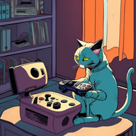

---
hide:
  - navigation
  - toc
---

{ width="120" }

# La Viciación

**La app privada para llevar la cuenta del tiempo que el grupo dedica a los videojuegos, y para picarse con ello.**

Pon un cronómetro cuando te sientes a jugar, o apunta la sesión a mano después. Todo lo demás sale de ahí: tu biblioteca por temporada, los rankings del grupo, las rachas, los logros y las recomendaciones. Un bot de Telegram y las notificaciones push mantienen al grupo informado.

## ¿Por dónde empiezo?

- :material-gamepad-variant: **Soy jugador**

    Cómo usar la app día a día: cronómetros, sesiones, biblioteca, rankings y logros.

    [:octicons-arrow-right-24: Guía de usuario](guia-usuario/index.md)

- :material-server: **Administro la instalación**

    Instalar, configurar `.env`, crear cuentas, Telegram, IA y copias de seguridad.

    [:octicons-arrow-right-24: Configuración](configuracion/index.md)

- :material-code-braces: **Toco el código**

    Arquitectura, convenciones, migraciones y flujo de trabajo.

    [:octicons-arrow-right-24: Documentación técnica](desarrollo/index.md)

